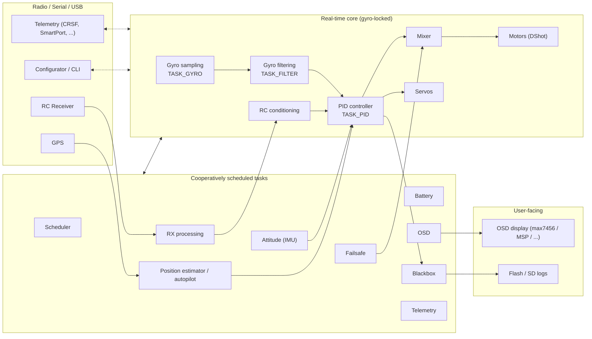

# Betaflight Firmware Architecture Analysis

> Deep dive into the architecture of [Betaflight](https://github.com/betaflight/betaflight) `2026.12` (calver, based on `4.x` development) — the open-source flight controller firmware for multirotor, fixed wing, and ROS-less drones.

This repository documents the internal architecture, design patterns, and engineering decisions behind Betaflight. The goal is to give programmers and contributors an accurate mental model of how the firmware is organized, how data flows through it, and where to change what.

**All paths in this analysis are relative to [`betaflight/`](./betaflight) and reference the source tree at commit `d593400a0`.**

## Table of Contents

| # | Document | Description |
|---|----------|-------------|
| 1 | [Architecture Overview](./docs/01-architecture-overview.md) | High-level system architecture, module map, and layering |
| 2 | [Boot & Startup](./docs/02-boot-and-startup.md) | `main()`, init phases, and boot-to-ready sequence |
| 3 | [Scheduler & Real-Time Loop](./docs/03-scheduler-realtime-loop.md) | Cooperative scheduler, task table, gyro-phase-locked loop |
| 4 | [Flight Control Pipeline](./docs/04-flight-control-pipeline.md) | Gyro → filters → attitude → PID → mixer → motors |
| 5 | [Drivers & Platform Abstraction](./docs/05-drivers-platform.md) | Vtables, bus subsystem, IO/resources, 9 MCU platforms |
| 6 | [Communication Stack](./docs/06-communication-stack.md) | RX protocols, telemetry, MSP, GPS, DroneCAN |
| 7 | [User Interfaces](./docs/07-user-interfaces.md) | OSD/CMS, CLI, VTX control, LED strip, beeper |
| 8 | [Blackbox & Storage](./docs/08-blackbox-and-storage.md) | Flight recorder, flashfs/asyncfatfs, USB MSC |
| 9 | [Configuration System](./docs/09-configuration-system.md) | Parameter Groups, EEPROM persistence, profiles, CLI/MSP binding |
| 10 | [Navigation & Autopilot](./docs/10-navigation-autopilot.md) | Position estimator, GPS rescue, pos/alt hold, wing L1 navigation |
| 11 | [Build System & Testing](./docs/11-build-system-and-testing.md) | Makefile, `TARGET`/`CONFIG` modes, unit tests, SITL |

## Tech Stack

- **Language**: C11 (C99-era mixed), no dynamic allocation, no RTOS
- **MCUs**: ST derivates (STM32 F4/F7/G4/H5/H7/C5/N6, APM32F4, GD32H7), AT32, RP2350 (PICO), ESP32, X32, plus **SIMULATOR** (SITL on Linux/macOS)
- **Parallelism**: none at OS level — single-threaded **cooperative scheduler** phase-locked to the gyro EXTI/interrupt clock
- **Wire protocols**: MSP v1/v2, CRSF/ELRS, SmartPort/F.Port, SBUS, IBUS, SRXL2, GHST, MAVLink, DSH bi-directional DShot, DroneCAN (libcanard)
- **Build**: GNU Make + per-MCU `.mk` fragments; board definitions from the [`betaflight/config`](https://github.com/betaflight/config) git submodule
- **Tests**: GoogleTest gray-box unit tests + a full **SITL** software-in-the-loop harness (virtual sensors over UDP)

## Source Stats

- `src/main`: **~930 source files**, **~206,000 lines** of C across 19 top-level modules
- `src/platform`: 9 platform families (STM32, common/stm32, APM32, AT32, GD32, PICO, ESP32, SIMULATOR, X32)
- `src/main/drivers`: **~160 driver files** (accgyro IMUs, barometers, displays, bus/serial infra…)
- `src/main/pg`: **~115 parameter-group headers** — one per persisted config struct
- Largest single files: `cli/cli.c` (9.4k LoC), `msp/msp.c` (5.1k LoC), `io/gps.c` (3.1k LoC), `flight/flight_plan_nav.c` (2.7k LoC), `blackbox/blackbox.c` (2.4k LoC)
- Two aircraft classes throughout the code: **multirotor** (quads, X8, tricopters…) and **wing** (flying wings, planes) — most flight modules come in `*_multirotor` / `*_wing` pairs

## The System at a Glance

Betaflight is a **single-threaded, hard real-time firmware** whose entire periodic behavior is driven by the gyro sample clock (typically 2–8 kHz). Everything else — attitude estimation, RC processing, OSD, telemetry, logging — is time-sliced into the CPU slack between gyro samples by a cooperative dynamic-priority scheduler.



## Why This Analysis?

Betaflight is one of the most demanding pieces of open-source firmware in existence. It combines:

- Hard real-time control at 8 kHz with sub-100 µs loop jitter requirements
- A clean hardware abstraction layer shipping on **9 different MCU families** with zero vendor-SDK leakage into portable code
- A pragmatic configuration system (Parameter Groups + EEPROM emulation + CLI/MSP views over the same data)
- A composable driver architecture built almost entirely on **function-pointer vtables** and opaque resource types instead of C++ classes

If you are a firmware engineer, there is a lot to learn here regardless of whether you work on drones, embedded real-time systems, or portable HAL design.

## Repo Layout

```
betaflight/
├── Makefile, mk/        # GNU Make build system (per-MCU fragments)
├── lib/                 # Vendored SDKs & modules (submodules: STM32 SDKs, pico-sdk, libcanard, esp-idf, gtest)
├── src/
│   ├── main/            # Portable firmware code (no vendor headers allowed)
│   │   ├── fc/          # Flight controller core: init, core loop, tasks, RC, arming
│   │   ├── scheduler/   # Cooperative task scheduler
│   │   ├── flight/      # PID, IMU, mixer, filters, failsafe, autopilot, navigation
│   │   ├── sensors/     # Sensor orchestration (gyro, acc, baro, mag, battery, ...)
│   │   ├── drivers/     # Hardware-agnostic driver interfaces & vtables
│   │   ├── platform.h   # Include-order contract for platform headers
│   │   ├── pg/          # Parameter Group declarations (persisted config)
│   │   ├── config/      # Config persistence: EEPROM serialization, streamer, profiles
│   │   ├── rx/          # RC receiver protocol implementations
│   │   ├── telemetry/   # Telemetry protocol implementations
│   │   ├── msp/         # MSP serial API (configurator protocol)
│   │   ├── cli/         # CLI shell + settings engine
│   │   ├── io/          # High-level IO: GPS, OSD display ports, VTX, LED, flashfs...
│   │   ├── osd/         # OSD engine & elements
│   │   ├── cms/         # Canvas Menu System (on-glass menus)
│   │   ├── blackbox/    # Flight recorder
│   │   ├── msc/         # USB mass-storage emulation for log access
│   │   ├── common/      # Shared utils (filter, strings, math, streams, crc...)
│   │   └── build/, msc/, target/   # build secrets/version, misc, generic target glue
│   ├── platform/        # Per-MCU implementations (STM32, PICO, ESP32, SIMULATOR, ...)
│   ├── config/          # (git submodule) Board definitions — hydrated with `make configs`
│   ├── test/            # GoogleTest unit tests + SITL harness
│   └── utils/           # Dev scripts
```

## License

This analysis is for educational purposes. Betaflight firmware is a project of the Betaflight community (GPLv3).
