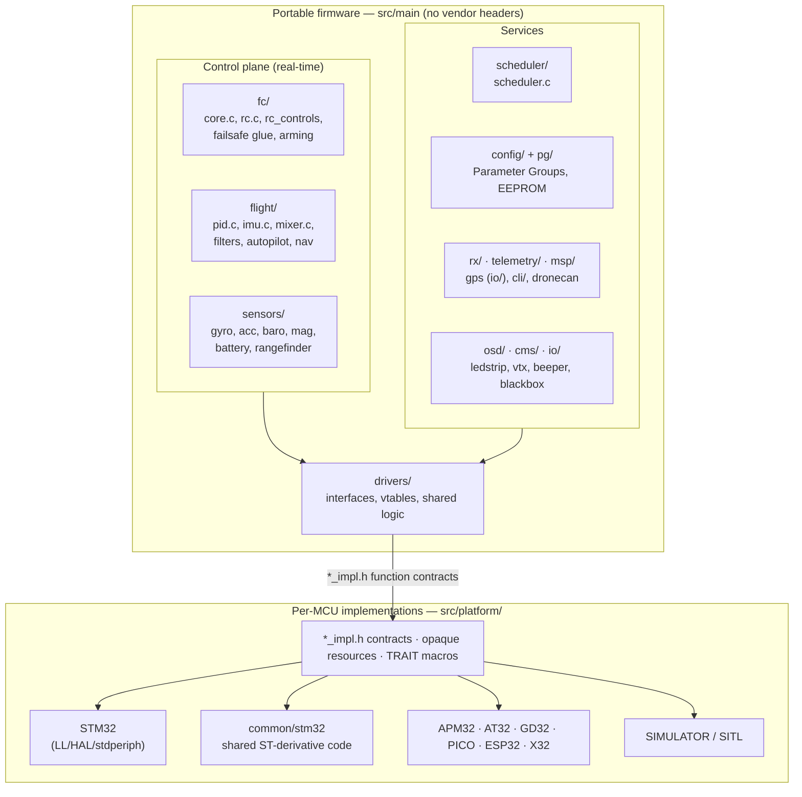
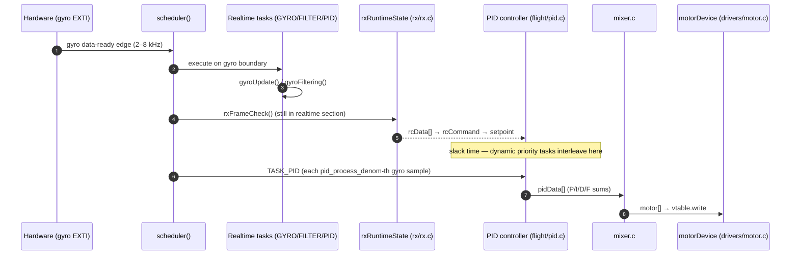
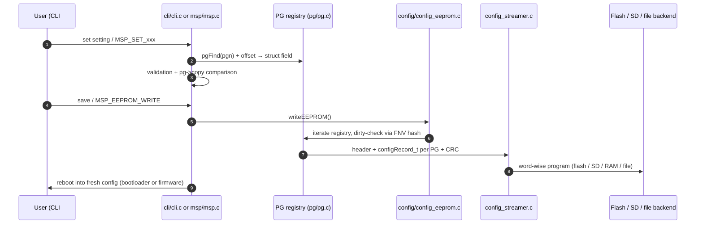

# 1. Architecture Overview

> Source tree analyzed: [betaflight/](../betaflight) at commit `d593400a0`, version `2026.12`.

Betaflight is a **bare-metal, single-tree C firmware** with no RTOS, no dynamic memory allocation, and no OS services. Its architecture can be described as four cooperating layers:

1. **A hard real-time control core** — the gyro→filter→PID→mixer loop, phase-locked to the gyro sample clock.
2. **A cooperative scheduler** that hands leftover CPU time to ~30 lower-priority tasks.
3. **A communication plane** — RX, telemetry, MSP, CLI — which is the *only* way the outside world reads or writes state.
4. **A hardware abstraction plane** — vtables + opaque resource types — that makes portable code (`src/main/`) completely vendor-SDK-free.

## Module map (src/main)

| Directory | Lines ~ | Responsibility |
|---|---|---|
| `fc/` | — | Flight controller core: boot phases (`init.c`), main loop glue (`core.c`), task table (`tasks.c`), RC processing, arming state, runtime flags |
| `scheduler/` | 0.6k | Cooperative scheduler: priority queue, dynamic aging, slack-time execution |
| `flight/` | — | Everything that flies the aircraft: PID (`pid.c`), attitude (`imu.c`), mixer (`mixer.c`), servos, failsafe, dynamic notch & RPM filters, autopilot, GPS rescue, navigation, position estimation |
| `sensors/` | — | Sensor *orchestration* (not hardware): detection (`initialisation.c`), gyro/acc/baro/mag/rangefinder/pitot pipelines, battery modeling |
| `drivers/` | — | Hardware-agnostic driver interfaces: bus transactions (SPI/I2C/QSPI/OCTOSPI), DShot, serial, IO/resource ownership, timers, DMA, EXTI, plus device families under `accgyro/`, `barometer/`, `compass/`, `flash/`, `can/`, `rx/`, `display/` |
| `rx/` | — | RC receiver protocol drivers (CRSF/ELRS, SBUS, IBUS, SRXL2, GHST, MSP RX, MAVLink RX, plus SPI-radio protocols: FrSky, FlySky, DSM, ExpressLRS…) |
| `telemetry/` | — | Telemetry protocol drivers (CRSF, SmartPort, FrSky hub, HoTT, LTM, MAVLink, IBUS, SRXL, GHST, MSP-shared) |
| `msp/` | 5.1k+1k | MSP protocol: the Betaflight Configurator's API, MSP v1/v2 framing, command dispatch (5.1k LoC in `msp.c`) |
| `cli/` | 9.9k | Interactive CLI shell (`cli.c`) + settings engine (`settings.c`) binding CLI names to Parameter Groups |
| `io/` | — | Mid-level IO: serial port allocation, GPS, display ports (`displayport_*.c`), VTX control, LED strip, beeper, flashfs, asyncfatfs, DroneCAN app layer, ESC 4-way passthrough |
| `osd/` | — | OSD engine: element rendering, warnings, stats screen |
| `cms/` | — | Canvas Menu System — on-glass menus shared across all display ports |
| `blackbox/` | 2.4k | Flight recorder: state machine, delta encoding, backends |
| `msc/` | — | USB mass-storage emulation of the blackbox volume (`emfat`) |
| `pg/` | — | Parameter Group headers — the schema of all persisted configuration |
| `config/` | — | Config persistence: EEPROM serialization, streaming writer, profile activation, feature system |
| `common/` | — | Filters (PT1/PT2/PT3/biquad/SVF), math, streams (`sbuf`), CRC, encodings, bitbanker |
| `build/` | — | Version/build info, debug pins, atomics |
| `msc/`, `target/` | — | USB MSC protocol glue; generic target headers (`common_pre.h`, `common_post.h`) |

Cross-cutting: about **115 headers in `pg/`** each declare one persisted config struct (one PG id, one EEPROM record).

### The `common/` toolbox

`src/main/common/` is shared vocabulary used by every layer — nothing there touches hardware:

| Utility | Purpose |
|---|---|
| `filter.c` / `sdft.c` | PT1/PT2/PT3, biquad, state-variable filter; sliding DFT (dyn notch) |
| `maths.c`, `vector.c`, `axis.h`, `explog_approx.c`, `pwl.c`, `uvarint.c` | float/vec math, axis indexing, approximations, varint encoding helpers |
| `streambuf.c` (`sbuf`/`bufWriter`) | bounded serializer/parser used by every wire protocol |
| `crc.c`, `huffman.c`, `encoding.c` | CRC-8/16 table generators, Huffman tables for blackbox readback, zigzag/4-bit encodings |
| `time.c`, `stopwatch.c`, `chirp.c` | microsecond helpers, exec-time auditing, sine-chirp generator (gyro FFT/dyn-notch debug) |
| `sensor_alignment.c` | sensor axis rotation/flip tables (board alignment for arbitrary sensor mounts) |
| `gps_conversion.c`, `colorconversion.c` | GPS coord formats; HSB/RGB for LED strip |
| `typeconversion.c`, `strtol.c`, `string_light.c`, `printf.c`, `printf_serial.c` | compact string/parse routines, no libc bloat |
| `bitarray.c`, `utils.h`, `unit.h` | bitmask helpers, misc macros, physical-unit annotations |

## The four architectural patterns that define this codebase

### 1. Gyro-phase-locked superloop

There is no RTOS and no preemption between tasks. `main()` sets up the world, then calls an infinite `while (true) scheduler();` loop. The scheduler's master clock is the **gyro data-ready interrupt** (EXTI), from which it derives every timed action; the gyro/filter/PID trio runs *inside* the realtime section on the exact gyro boundary, and everything else runs in the remaining slack time. See [Scheduler & Real-Time Loop](./03-scheduler-realtime-loop.md).

### 2. Vtable polymorphism at every layer seam

Whenever portable code must reach a piece of hardware or an alternate implementation, the seam is a `const *VTable` of function pointers inside an opaque struct:

- `motorDevice_t` → `motorVTable_t` (DShot DMA / DShot bitbang / PWM analog / DroneCAN / null)
- `serialPort_t` → `serialPortVTable` (UART / USB VCP / TCP for SITL)
- `displayPort_t` → `displayPortVTable_t` (max7456 / MSP / FrSkyOSD / CRSF / OLED…)
- `vtxDevice_t` → `vtxVTable_s` (SmartAudio / Tramp / MSP / RTC6705)
- sensor devices use *instance* function pointers instead (`gyroDev_t.readFn`, `baroDev_t.up_down` pipeline callbacks)

See [Drivers & Platform Abstraction](./05-drivers-platform.md).

### 3. Parameter Groups as the single source of truth for configuration

Every persisted setting lives in a **Parameter Group (PG)**: a struct registered into a linker section at build time, with a fixed 16-bit id (`pg/pg_ids.h`), a schema *version*, a defaults template, and (optionally) a reset function. EEPROM persistence, `dump/diff` in the CLI, and `MSP_SET_*` in the protocol all operate on the *same* PG structs — there is no duplicated config model. See [Configuration System](./09-configuration-system.md).

### 4. Portable core vs. per-MCU platform tree

`src/main/` never includes a vendor SDK header. Peripheral handles are **opaque resource types** (`spiResource_t`, `dmaResource_t`, `timerResource_t`) and platform headers inject *compile-time traits* (`SPI_TRAIT_AF_PIN`, `DMA_TRAIT_CHANNEL`…). Each of the 9 platform families supplies the functions declared in `*_impl.h` contracts. Which implementations get compiled is decided by the per-MCU `.mk` source lists — not by `#ifdef` inside shared files. See [Drivers & Platform Abstraction](./05-drivers-platform.md) and [Build System & Testing](./10-build-system-and-testing.md).

## Request lifecycles worth knowing

Three distinct "spines" show how layers interconnect:

**Configuration write** (CLI or Configurator) always obeys the same contract:

**Telemetry/read** flows outwards through protocol-specific frames fed by one low-priority task (`TASK_TELEMETRY`), with CRSF/SmartPort being strictly *demand-slot* machines (transmit only when the receiver clears a slot), and MSP-over-telemetry multiplexing the whole configurator API through those slots.

## Where the real-time boundary is

A crucial nuance for contributors:

| Thing | Runs where |
|---|---|
| gyro read, gyro filtering | Realtime section, locked to gyro EXTI |
| PID + mixer + motor write | Realtime section, half-period offset from filter |
| `rxFrameCheck` (ELRS serial decode) | Realtime section — deliberately, because ELRS parsing is slow |
| failsafe watchdog `failsafeUpdateState` | Realtime section (independent of the check-func mechanism) |
| attitude estimation (`imuUpdateAttitude`) | Scheduled task at 100 Hz (or acc-rate/denominator) |
| RX channel processing (`processRx*, updateRcCommands`) | Event-driven `TASK_RX` with per-state time budget |
| everything else (OSD, telemetry, blackbox low-rate parts, GPS, LED…) | Dynamic-priority queue with aging |

This explains the recurring design idea that same-named logic exists in two flavors: e.g. gyro filtering exists both as a realtime chain (`gyro_filter_impl.c`, template-instantiated for speed) and as configuration (`gyro_init.c`), and the mixer filter (`updateDynLpfCutoffs`) is called from inside `mixTable()` because cutoff switching must line up exactly with throttle changes in the realtime loop.
