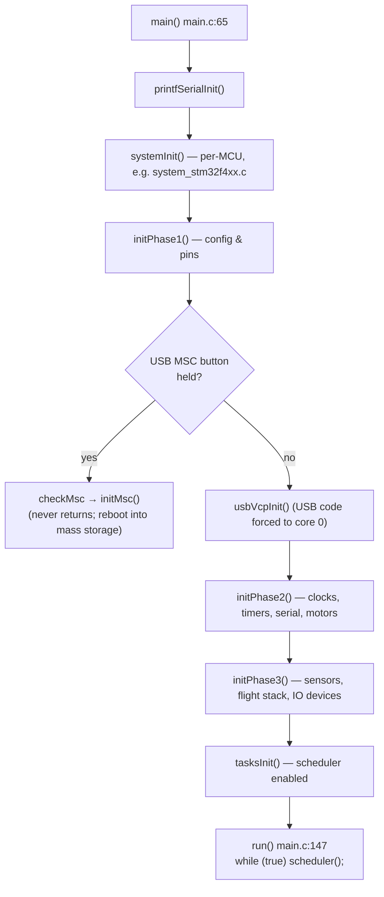
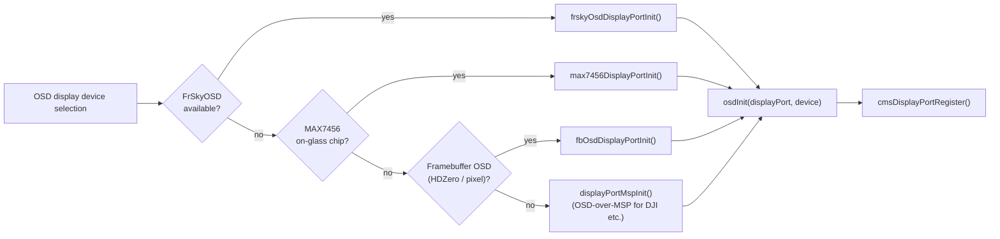
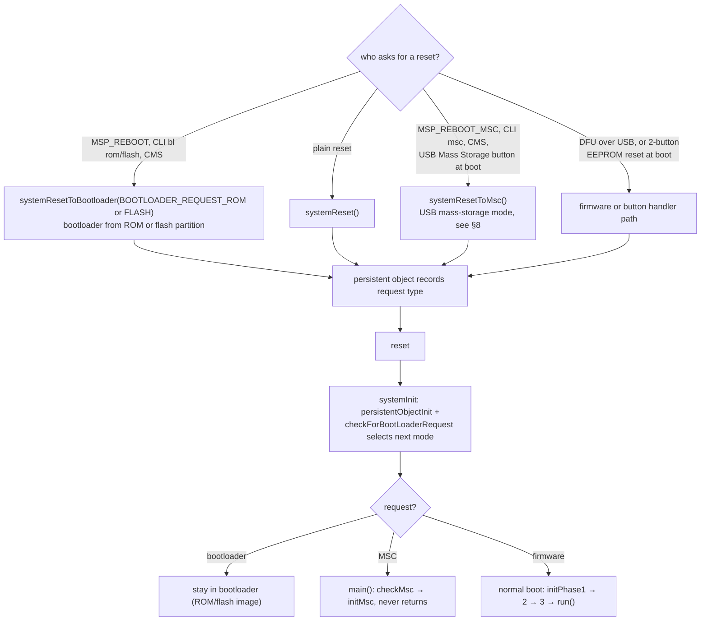

# 2. Boot & Startup

Entry point: [`src/main/main.c:65`](https://github.com/betaflight/betaflight/blob/d593400a0/src/main/main.c#L65) → `main()`. The file is deliberately tiny: it wires up init phases and then hands over to an infinite scheduler loop.



## systemInit() — platform layer

Declared in `drivers/system.h`, implemented per MCU family (e.g. `src/platform/STM32/system_stm32f4xx.c:147`):

1. `persistentObjectInit()` — persistent-memory scratch for reset requests (MSC mode, DFU, bootloader)
2. `checkForBootLoaderRequest()`
3. `SetSysClock()` — clock tree setup
4. NVIC priority grouping and vector-table setup
5. Cache RCC reset flags (used by `isMPUSoftReset()`)
6. `cycleCounterInit()` — the DWT cycle counter; **this is the scheduler's timebase**
7. `SysTick_Config(SystemCoreClock / 1000)` — 1 ms tick for retry loops

## initPhase1() — config & pins before buses (fc/init.c:296)

Ordered highlights:

| Step | What | Notes |
|---|---|---|
| 1 | `tasksInitData()` | binds `tasks[i].attribute = &task_attributes[i]` |
| 2 | `IOInitGlobal()`, `targetConfiguration()`, `configTargetPreInit()` | board-specific hooks from the config/target tree |
| 3 | Early SD-card/external-flash init (`pgResetAll()`, `sdCardAndFSInit()`, `flashInit()`) | needed when config storage lives on SD or external flash; waits for `AFATFS_FILESYSTEM_STATE_READY` |
| 4 | `initEEPROM(); readEEPROM()` | loads all Parameter Groups; validates version, board identifier match |
| 5 | On load fault | `resetEEPROMOnLoadFault()` — flashes defaults |
| 6 | `ledInit()`, `EXTIInit()`, debug pin, pinio, `debugMode` | system state flagged `SYSTEM_STATE_CONFIG_LOADED` |

## initPhase2() — timers, serial, motors (fc/init.c:445)

| Step | What | Notes |
|---|---|---|
| 1 | `buttonsInit()` + 2-button EEPROM reset latch | |
| 2 | `spektrumBind()` | deliberately before HSE/overclock soft-reset paths |
| 3 | `systemClockSetHSEValue()`, overload `OverclockRebootIfNecessary()` | |
| 4 | `mcoInit()`, `timerInit()` | timers claimed *before* any channel allocation |
| 5 | `uartPinConfigure()`, `serialInit()` | builds the serial port usage table |
| 6 | `mixerInit()`, `motorDevInit()` | early — prevents spurious motor pulses; `SYSTEM_STATE_MOTORS_READY` |
| 7 | `ppmRxInit`/`pwmRxInit`, `beeperInit()`, `initInverters()` | |
| 8 | `targetBusInit()` or explicit `configureSPIBusses()` / Quad / Octo / SDIO | `initFlags` guard avoids double-config |

## initPhase3() — sensors → flight stack → IO devices → tasks (fc/init.c:656)

This is the interesting one — order matters:

```
i2cInit → CAN/DroneCAN init → adcInit
  → initBoardAlignment() → sensorsAutodetect()          ← failure ⇒ ARMING_DISABLED_NO_GYRO
  → gyroSetTargetLooptime() → validateAndFixGyroConfig()  ← sets gyro:PID division (pid_process_denom)
  → initDshotTelemetry() → gyroInitFilters()
  → pidInit() → mixerInitProfile() → servosInit()
  → imuInit() → failsafeInit() → rxInit()
  → gpsInit() → ledStripInit() → escSensorInit()
  → flashInit() → flashfsInit() → blackboxInit()
  → gyroStartCalibration() (+acc/baro as needed)
  → positionInit() → autopilotInit() → flightPlanNavInit()
  → vtxInit family (table + control + per-protocol devices)
  → batteryInit() → mspInit() + mspSerialInit() → cmsInit()
  → OSD displayport selection fallback chain → osdInit()
  → dashboardInit() → telemetryInit()
  → setArmingDisabled(ARMING_DISABLED_BOOT_GRACE_TIME)
  → spiInitBusDMA() → motorPostInit() → motorEnable()
  → tasksInit() → SYSTEM_STATE_READY
```

### OSD displayport fallback chain

`fc/init.c:939–1014` picks the OSD surface at boot:



### Sensor detection

`sensorsAutodetect()` (see [§4 Flight Control Pipeline](./04-flight-control-pipeline.md#sensors--autodetection)) probes gyro/acc/baro/mag over configured buses. Gyro detection failure is fatal for arming (30 `armingDisableFlags` bars; see [§3](./03-scheduler-realtime-loop.md#arming-state)).

## Boot-time choice of subsystems vs. battery profiles

Note `initPhase3` activates **PID profile** (`pidInit(currentPidProfile)`), **battery profile** (`batteryInit()`), and later may *switch* PID profile from cell count (`changePidProfileFromCellCount`) — config activation is spread between boot and runtime (see [§9 Configuration System](./09-configuration-system.md#profile-activation--runtime-switching)).

## The run loop

```c
// main.c:147
void FAST_CODE run(void)
{
    while (true) {
        scheduler();
#if defined(RUN_LOOP_DELAY_US) && RUN_LOOP_DELAY_US > 0
        delayMicroseconds_real(RUN_LOOP_DELAY_US);   // hosted targets only
#endif
    }
}
```

Everything that ever happens afterwards is inside `scheduler()`, covered in the next chapter.

## System state flags

`fc/init.c:197` accumulates `systemState` bit flags which IOC code uses to avoid touching half-initialized subsystems:

`SYSTEM_STATE_INITIALISING → CONFIG_LOADED → MOTORS_READY → SENSORS_READY (+ TRANSPONDER_ENABLED) → READY`.

## Reset & reboot paths

All reset requests funnel through *persistent objects* (battery/RTC-backed scratch RAM) written **before** the reset, then consumed by `systemInit` on the next boot:



Other reset consumers to know:

| Trigger | Path |
|---|---|
| CLI `save`/`defaults`/`exit` | `writeEEPROM()` + `cliRebootEx` → reset (fresh config validated on next boot) |
| MSP `MSP_EEPROM_WRITE` | deferred via dispatch queue (`writeReadEepromEntry`) so the reply is sent first |
| Settings `cliEnter`/MSP pending | `mspProcessPendingRequest` handles `MSP_PENDING_BOOTLOADER_ROM/FLASH/CLI` after reply flush |
| CPU overload / runaway takeoff | leaves device armed-disabled only; no automatic reset (users disarm manually) |

## Hard fault behavior

`fc/faults.c:41 systemFaultAction()` is invoked from HardFault/MemManage/BusFault/UsageFault handlers (platform-dependent). It is the last defense: it records the fault beacon for the configurator and strobes LEDs. There is no stack unwinding or recovery — a fault is a fault.
