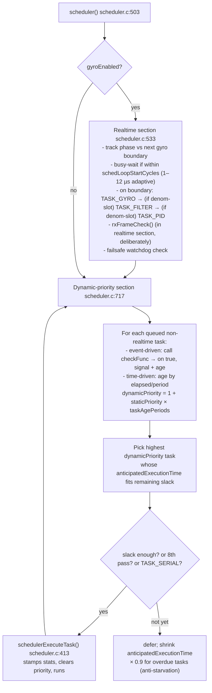
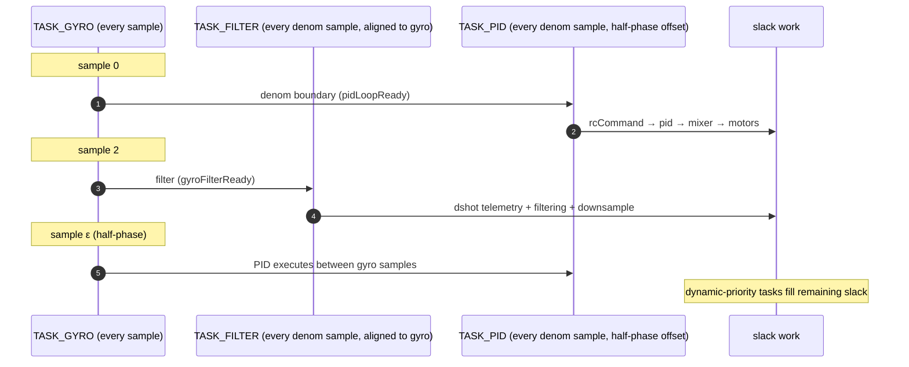
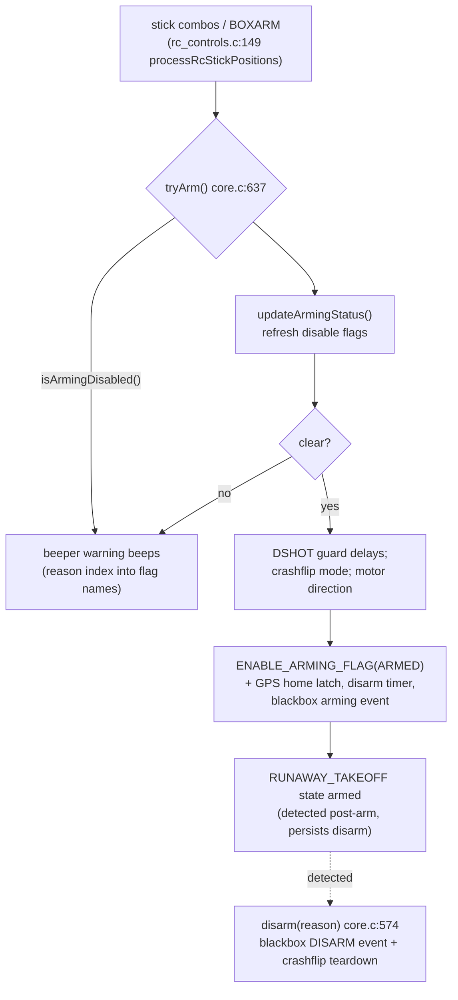

# 3. Scheduler & Real-Time Loop

Files: [`src/main/scheduler/scheduler.c`](https://github.com/betaflight/betaflight/blob/d593400a0/src/main/scheduler/scheduler.c) (~850 LoC), [`src/main/fc/tasks.c`](https://github.com/betaflight/betaflight/blob/d593400a0/src/main/fc/tasks.c), interplay in [`src/main/fc/core.c`](https://github.com/betaflight/betaflight/blob/d593400a0/src/main/fc/core.c).

There is **no RTOS**. The whole firmware is a single cooperative scheduler whose periodic master clock is the **gyro data-ready interrupt**.

## Structure of a scheduler pass



Key mechanics:

- **Phase locking**: `nextTargetCycles` is continuously re-derived from the actual gyro EXTI count over a 25 000-interrupt window with periodic skew correction (every 50 interrupts) — the loop *locks onto* the gyro clock rather than its own timer.
- **Dynamic aging** (the "time slicing"): every queued task grows `dynamicPriority` as it ages past its period; higher `staticPriority` tasks age faster. The highest-priority task that fits the remaining slack runs.
- **anticipatedExecutionTime** is a peak-hold estimate of how long the task takes, decayed by shifting (`TASK_EXEC_TIME_SHIFT = 7`), used to decide whether a task fits the current slack window.
- **`SCHED_TASK_DEFER_MASK = 0x07`**: every 8th scheduler pass ignores the "does it fit?" test so long tasks eventually run; `TASK_SERIAL` is never blocked because configurator responsiveness depends on it.
- **Late statistics**: moving sums, `maxExecutionTimeUs`, late-task counters (`USE_LATE_TASK_STATISTICS`) feed `TASK_SYSTEM` (`taskSystemLoad`, `averageSystemLoadPercent`), which also raises the `ARMING_DISABLED` `LOAD` flag if the CPU is drowning.

## Task table

`task_t tasks[TASK_COUNT]` (tasks.c:401) + `task_attributes[]` built with `DEFINE_TASK` (tasks.c:391). Priorities: `TASK_PRIORITY_REALTIME = -1` (runs outside the scheduler queue), `LOWEST=1 … HIGH=5`.

The realtime trio runs at the gyro rate (typically **8 kHz** on modern STM32, `TASK_GYROPID_DESIRED_PERIOD = 125 µs`), while the other tasks keep their own frequencies:

| Task | Typical rate | Priority | What it does |
|---|---|---|---|
| `TASK_GYRO` (`taskGyroSample`, core.c:1562) | gyro rate (8 kHz) | REALTIME | `gyroUpdate()` — raw sample via accgyro driver vtable |
| `TASK_FILTER` (`taskFiltering`, core.c:1589) | gyro rate / denom | REALTIME | `updateDshotTelemetry()` + `gyroFiltering()` (filter chain + downsample) |
| `TASK_PID` (`taskMainPidLoop`, core.c:1598) | gyro rate / denom | REALTIME | RC → PID → mixer → servos → motors; blackbox subtask |
| `TASK_ACCEL` | 1 kHz | MEDIUM | accelerometer read (feeds attitude & gravity) |
| `TASK_ATTITUDE` | 100 Hz (or acc/denom) | MEDIUM | `imuUpdateAttitude()` — quaternion update |
| `TASK_RX` (`taskUpdateRxMain`) | check-func event-driven | HIGH | 3-state machine: `RX_STATE_CHECK → processRx()`, `RX_STATE_MODES → processRxModes()`, `RX_STATE_UPDATE → updateRcCommands() + updateArmingStatus()` |
| `TASK_SERIAL` | 100 Hz | LOW | `mspSerialProcess()` + watchdog refresh (never deferred) |
| `TASK_DISPATCH` | 1 kHz | HIGH | delayed-callback queue (`dispatchAdd/processProcess`) |
| `TASK_BATTERY_VOLTAGE / _CURRENT / _ALERTS` | 10–50 Hz | MEDIUM | battery model (see §4) |
| `TASK_GPS` / `TASK_GPS_RESCUE` | ~10 Hz / 20 Hz | MEDIUM | NMEA/UBX decode; rescue state machine |
| `TASK_POSITION` | ~10 Hz | LOW | position estimator update (consumers notified) |
| `TASK_ALTHOLD` / `TASK_POSHOLD` | event-driven | LOW | altitude/position hold mode logic for both airframe classes |
| `TASK_BARO` / `TASK_PITOT` | ~35 Hz | LOW | self-rescheduling to sensor readiness deadlines |
| `TASK_OSD` | ~60 Hz (check-func) | LOW | `osdUpdate()` — incremental element drawing |
| `TASK_TELEMETRY` | 250 Hz (500 Hz for CRSF/Jeti) | LOW | `telemetryProcess()` → per-protocol `handle*Telemetry()` |
| `TASK_LEDSTRIP` | ~50 Hz | LOW | WS2811 update |
| `TASK_BEEPER` | 100 Hz | LOW | beeper pattern engine |
| `TASK_ESC_SENSOR` | 100 Hz | LOW | DShot eRPM/EDT aggregation |
| `TASK_VTXCTRL` / `TASK_CAMCTRL` / `TASK_RCDEVICE` | 5–20 Hz | LOW | VTX/Camera/RC device protocols |
| `TASK_CMS` | 20 Hz | LOW | on-glass menu navigation |
| `TASK_STACK_CHECK` | 10 Hz | LOWEST | stack watermark |
| `TASK_ADC_INTERNAL` | 1 Hz | LOWEST | VREFINT calibration |
| `TASK_DRONECAN` | 50 Hz | LOW | DroneCAN node loop |
| `TASK_SYSTEM` | 10 Hz | MEDIUM_HIGH | CPU load measurement |

`tasksInit()` (tasks.c:573) decides which tasks are actually enabled based on compiled features, detected sensors, and flight mode gating (`tasksUpdateModeGatedEnables()` re-evaluates when mode ranges change over MSP). Tasks may be rescheduled at runtime (`rescheduleTask`) — e.g. `TASK_GYRO/FILTER/PID` are re-targeted to the actual `gyro.sampleLooptime`.

## The gyro/PID relationship (`pid_process_denom`)

`gyroSetTargetLooptime()` maps a PID loop rate onto the gyro sample rate: IMUs are sampled at 8 kHz while the PID loop may run at 8/4/2/1 kHz (`pid_process_denom`). The realtime section schedules filter and PID half a denom phase apart so they never collide:



This means gyro data used by the PID loop is always the *filtered downsampled* buffer (`gyroGetFilteredDownsampled`), and filtering happens *between* PID iterations — a property module authors must respect (e.g. `gyro.targetLooptime` is the *filter* period, not the PID period).

## RX scheduling detail

`taskUpdateRxMain` is not just a periodic call; it is a 3-state machine using per-state execution-time budgets:

```
RX_STATE_CHECK   → rxUpdateCheck() verifies new protocol frame status via rcFrameStatusFn
                   → on RX_FRAME_PROCESSING_REQUIRED → RX_STATE_PROCESS
RX_STATE_PROCESS → processRx() (read channels, apply ranges, signal-loss policy)
                   → RX_STATE_MODES
RX_STATE_MODES   → processRxModes() (updateActivatedModes, stick positions, arming)
                   → RX_STATE_UPDATE
RX_STATE_UPDATE  → updateRcCommands() + updateArmingStatus()
                   → back to check
```

`rxUpdateCheck` (rx.c:558) is the *check function* installed for `TASK_RX`: the event-driven model means the rx task sits dormant until a receiver promises a frame, an important trick to keep input latency low without polling.

## Arming state

Arming is driven by `armingDisableFlags` — a 30-bit bitmask maintained by `updateArmingStatus()` (core.c:357) and evaluated per cycle on the disarmed side. Order encodes priority for human-readable warnings:

```
NO_GYRO, FAILSAFE, RX_FAILSAFE, NOT_DISARMED, BOXFAILSAFE, RUNAWAY_TAKEOFF,
CRASH_DETECTED, THROTTLE, ANGLE, BOOT_GRACE_TIME, NOPREARM, LOAD, CALIBRATING,
CLI, CMS_MENU, BST, MSP, PARALYZE, GPS, RESC, DSHOT_TELEM, REBOOT_REQUIRED,
DSHOT_BITBANG, ACC_CALIBRATION, MOTOR_PROTOCOL, CRASHFLIP, ALTHOLD, POSHOLD,
AUTOPILOT, ARM_SWITCH
```



Flight modes (`flightModeFlags`: ANGLE, HORIZON, MAG, ALT_HOLD, POS_HOLD, HEADFREE, FAILSAFE, GPS_RESCUE, AUTOPILOT, LAUNCH…) are refreshed every RX cycle by `updateActivatedModes()` (rc_modes.c:161) from the `modeActivationConditions` PG plus sticky-mode logic; everything else reads them via `IS_RC_MODE_ACTIVE(boxId)`.

## Stats and health

- `taskSystemLoad` computes `averageSystemLoadPercent` from idle-slack accounting; when overloaded it sets `ARMING_DISABLED_LOAD` and can trigger runaway-takeoff-style disarm after flight.
- `TASK_STACK_CHECK` walks the main task's stack watermark (extended per-ISR contexts on multicore platforms).

## Delayed callbacks (`fc/dispatch.c`)

A tiny sorted singly-linked queue of delayed callbacks: `dispatchAdd(dispatchEntry)` / `dispatchProcess()` runs from `TASK_DISPATCH` (1 kHz). Used wherever an action must be deferred past the current call frame:

- `mspRebootEntry` / `writeReadEepromEntry` — MSP replies are flushed before reboot/EEPROM write (msp/msp.c:467, :490)
- persistent stats throttled writes (`fc/stats.c:85`: `writeStatsEntry` after `STATS_SAVE_DELAY_US`)
- `dispatchEnable()` is bound by SPI RX protocols that have no permanent data-ready EXTI (rx/rx_spi.c:272) to drive their state machines from the scheduler
