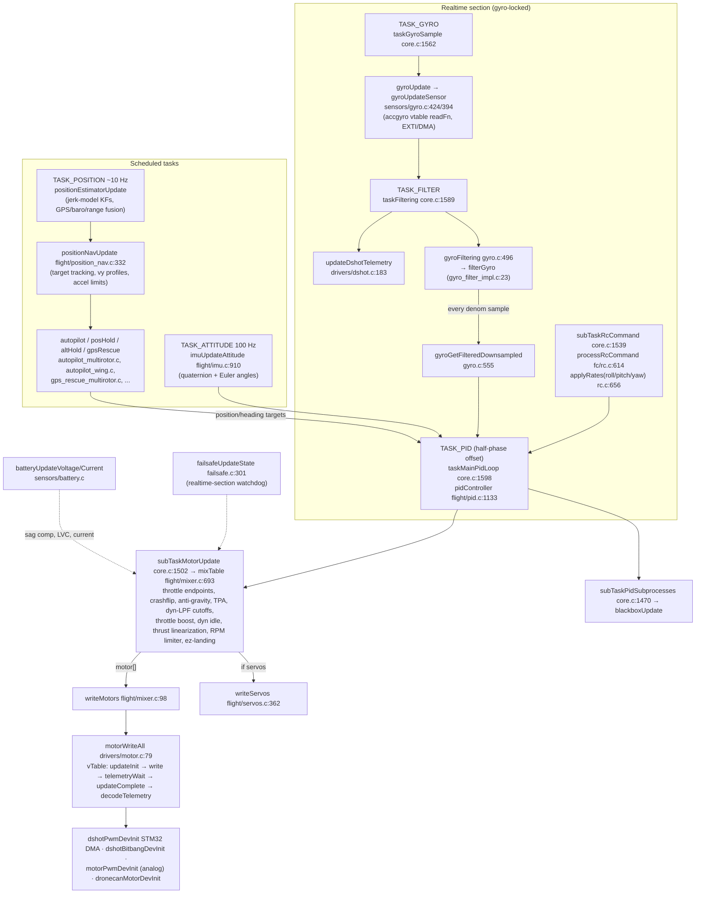
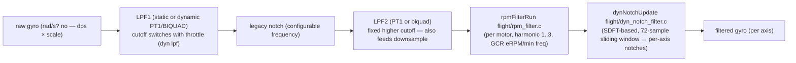
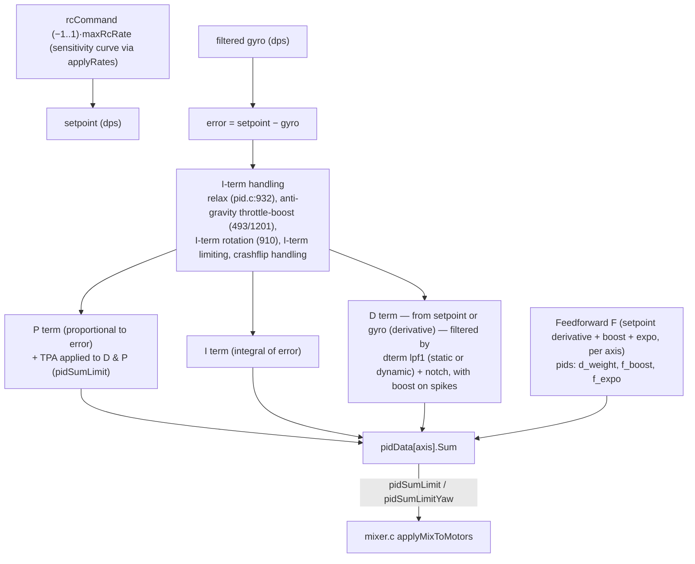
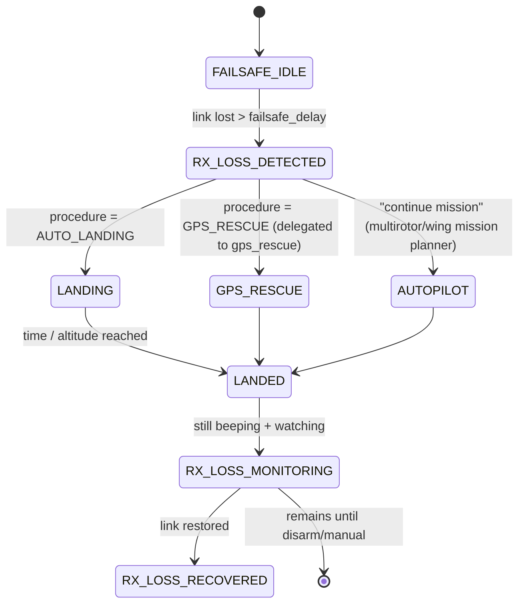

# 4. Flight Control Pipeline

Files: [`src/main/flight/`](https://github.com/betaflight/betaflight/tree/d593400a0/src/main/flight) (PID, IMU, mixer, filters, failsafe, autopilot, navigation), [`src/main/sensors/`](https://github.com/betaflight/betaflight/tree/d593400a0/src/main/sensors), glue in [`src/main/fc/core.c`](https://github.com/betaflight/betaflight/blob/d593400a0/src/main/fc/core.c).

## The complete data path

Two notable splits:

- **Gyro read vs filter** are separate realtime tasks (see §3) — the PID loop consumes only the *filtered & downsampled* gyro buffer, and filtering/decoding (DShot telemetry) happens between PID iterations.
- **Attitude** is *not* inline: orientation estimation runs as a 100 Hz scheduled task, not inside the PID loop. The PID loop only ever sees `pidSetpoint` (from RC/rates/autopilot), filtered gyro, and attitude-derived data.

## Gyro sampling & detection

- `gyroDetect()` / `gyroDetectSensor` (`sensors/gyro_init.c:360/607`) walk configured IMU instances (`pg/gyrodev.h gyrosDetected` bitmask, persisted). Detection is shared: `mpuDetect()` (`drivers/accgyro/accgyro_mpu.c:472`) probes WHO_AM_I over SPI/I2C and dispatches per-chip drivers (MPU6000/6500/9250, BMI160/270/423, ICM20649/089/426xx/456xx/56686, LSM6DSO/DSV16X, L3GD20, virtual for SITL). Each driver sets `gyroDev_t.initFn/readFn` and `scale` (`GYRO_SCALE_2000DPS/4000DPS`).
- EXTI mode: `GYRO_EXTI_INIT / INT_DMA / INT / NO_INT` — the driver prepares DMA-described register-read segments (`gyroDev_t.busSegment_t`), the scheduler fires on the data-ready edge, and reads happen either as DMAed SPI transactions or polled.
- Orientation: `initBoardAlignment()` (`boardalignment.c`) rotates/mitigates mount-multiplication before any pipeline use.
- Calibration: `gyroStartCalibration()` from initPhase3 with `gyro_cal_on_first_arm` option; `accCalibration` similar with `acc_needs_calibration` surfaced via arming-disable `ACC_CALIBRATION`.

## Gyro filter chain (order-sensitive)

Filters are composed at runtime by `gyroInitFilters()` (`gyro_init.c`) and applied in `gyroFiltering()` through `gyro_filter_impl.c` — a compile-time template that produces specialized, debug-instrumented variants to stay inside the loop budget.

- **Dyn lpf** — `updateDynLpfCutoffs` (`flight/mixer.c:547`) is called *inside* `mixTable()` because throttle updates must retune the LPF1 cutoff exactly at realtime.
- **RPM filter** — needs DShot bidirectional telemetry; motor RPM LPFs are maintained in `drivers/dshot.c` (`updateDshotTelemetryQuality`, `getDshotRpmAverage`) and consumed per-axis by `rpmFilterRun`.
- **Dyn notch** (`flight/dyn_notch_filter.c:257`) uses the sliding DFT (`common/sdft.h`, 72-sample window → 36 bins) rather than FFT tracking; weighted peak tracking per axis.
- **D-term filtering** is separate — D filters (`lowpass_dterm` PT1/biquad, plus one dterm notch and dynamic dterm LPF1) are applied per axis *inside* `pidController` (`flight/pid.c:1225`), driven from `pid_init.c`.

Generic primitives live in `common/filter.c` (PT1/PT2/PT3 with known static gain corrections, biquad, state-variable filter, first-order LPF).

## Attitude estimation

`flight/imu.c` maintains a quaternion and derives yaw/pitch/roll:

- **MAG-less default**: gravity vector from acc (timed-fused after `acc.jerkMagnitude`-y gating), yaw from gyro integration with **correction from GPS/course when flying with heading hold**, never free-running drift indefinitely.
- **imuUpdateAttitude** (`imu.c:910`) → `imuUpdateEulerAngles` (`imu.c:329`).
- Head-compensating: `imuQuaternionHeadfreeOffsetSet()` (headfree support).
- Wind-up safety: `isUpright()` gates arming (`ARMING_DISABLED_ANGLE`).
- Wing frames additionally feed `position_estimator.c` with pitot/baro/rangefinder inputs — position estimation and wing altitude control live in `flight/position_*.c` / `autopilot_wing.c` (see [§10 Navigation & Autopilot](./10-navigation-autopilot.md)).

## PID controller

`flight/pid.c` (~1.8k LoC): `setPIDController()` selects `applyBetaflightRates`/`applyRaceFlightRates`/`applyKissRates`/`applyActualRates`/`applyQuickRates` as the `applyRatesFn` function pointer in `fc/rc.c:850–862` — rate models (Betaflight/RaceFlight/KISS/Actual/Quick) are chosen per profile.

Per axis:

Runaway-takeoff protection (core.c:1424–1461): if the PID Sum exceeds thresholds with low throttle, the firmware disarms with `ARMING_DISABLED_RUNAWAY_TAKEOFF`; recovery requires a disarm-then-rearm cycle.

Additional features that hook in here:
- **Anti-gravity**: throttle-dependent I gain (and pitch P boost).
- **Crashflip** (`crashFlipModeActive`, core.c:158): PID sums are clamped and motor spin direction is reversed during arming, letting the quad flip to escape crashes.
- **`disarmOnImpact`** (`flight/pid.c:967`): EZ-Landing jerk-based disarm off `acc.jerkMagnitude` vs `landingDisarmThreshold`.
- **Launch control** (`launchWingUpdate`, `launch_wing.c`): wing-only, inserted *between* RC and PID (core.c:1616), with I-term reset on launch.

## Mixer

`flight/mixer.c` + `mixer_init.c`: a table of predefined mixers (quad X/X4, hex, octo, Y, tri, single tilted, FLYING_WING, AIRPLANE, CUSTOM/ CUSTOM AIRPLANE, mixers[] table in mixer_init.c:253).

- `mixTable()` in order: throttle endpoints → crashflip override → **PID sum limiting** (with increased limits during yaw-spin recovery) → throttle limit → anti-gravity throttle filter → TPA → dyn-LPF cutoff update → throttle boost → dynamic idle → thrust linearization → **RPM limiter** → applyMixerAdjustment (legacy/linear/ez-landing) → `applyMixToMotors` → `motor[]`.
- Motor count & servo usage come from the selected mixer (`mixers[]`, `motorMixer_t`).
- **Custom mixers**: `customMotorMixer` is a *PG array* (`PG_MOTOR_MIXER`, `MAX_SUPPORTED_MOTORS` entries) used when `mixerMode == CUSTOM`; edited via CLI `mmix`.
- Servos: `writeServos()` (`servos.c:362`) is called after `mixTable` because servo mixing derives from motor outputs (`servoMixers[]` rules per airframe, presets for plane/wing/tri/gimbal). Butterfly/flying-wing servo xOffset, invertedServo logic, `servosFilterInit`.

## Motor output → DShot

`drivers/motor.c` is the boundary:

1. `mixerInit()` → `motorInitEndpoints()` — protocol + count → per-motor endpoints (PWM: 1000–2000 µs; DShot: 48–2047 raw).
2. `motorDevInit()` (motor.c:299–351) selects vtable:
   - `dronecanMotorDevInit` — CAN-based ESCs (DroneCAN RawCommand)
   - `motorPwmDevInit` — analog: PWM / OneShot125 / OneShot42 / Multishot / brushed
   - `dshotBitbangDevInit` — bit-banged via DMA→GPIO (compatible everywhere, even without timers)
   - `dshotPwmDevInit` — timer DMA DShot150/300/600 + ProShot1000
3. `motorWriteAll()` runs the frame sequence (bitbang: `updateInit → write → telemetryWait → updateComplete → decodeTelemetry`; timer-DMA: decode previous telemetry first, then write, then `updateComplete`).

Bidirectional DShot: after TX, the same DMA stream is reconfigured as memory-to-memory edge capture (`pwmDshotSetDirectionInput`, `pwm_output_dshot_hal.c`) to record GCR edges (`MAX_GCR_EDGES 22`); `pwmTelemetryDecode` (pwm_output_dshot_shared.c:260) decodes eRPM or EDT (temperature/current/voltage) packets and feeds `dshotTelemetryState.motorState[]`.

DSHOT commands (`dshot_command.c`): a queue of BLOCKING (motor-stop required: calibrations, spin direction, save, beacons 1–5) and INLINE (streamed into normal frames: e.g. EDT enable) commands, plus `dshotCommandWrite` used from migratory paths (arming beacon commands, crashflip direction).

## Failsafe

`flight/failsafe.c` runs an independent RX-loss watchdog in the realtime section (`failsafeCheckDataFailurePeriod` + `failsafeOnValidDataReceived/Failed` called directly from RX bookkeeping), then a state machine in `failsafeUpdateState` (`failsafe.c:301`):

- Procedures: `AUTO_LANDING / DROP_IT / GPS_RESCUE` (plus FAILSAFE_AUTOPILOT mission continuation elected by core.c rules; multirotor rescue lives in `gps_rescue_multirotor.c`, wing in `gps_rescue_wing.c` — see [§10 Navigation & Autopilot](./10-navigation-autopilot.md)).
- Switch mode: `FAILSAFE_SWITCH_MODE_STAGE1 / KILL / STAGE2` (`failsafe_switch_mode`), `failsafe_recovery_delay`, `failsafe_landing_time` (s, capped at `FAILSAFE_LANDING_TIME_MAX 250`), failsafe intervals use 0.1 s steps (`failsafe_delay`), power-on grace 5 s (`FAILSAFE_POWER_ON_DELAY_US`).
- Under Failsafe the flight mode bit `FAILSAFE_MODE` is set, rcData falls to `rxFail` values (or AUTO/HOLD semantics computed in `rx/rx.c detectAndApplySignalLossBehaviour`), so PID/mixer see a deterministic input.

## Battery & power modeling

- `batteryUpdateVoltage` selects source (ADC/ESC telemetry/none), then `voltageStableUpdate`, `batteryUpdatePresence` (auto cell count with `vbatnotpresentcellvoltage` threshold, `forceBatteryCellCount`), threshold recalc vs `vbathysteresis`, `batteryUpdateLVC` (ramps down `lvcPercentage` over `LVC_AFFECT_TIME`), consumption modeling (`batteryUpdateWhDrawn`), state machine `batteryState = MAX(voltage, consumption)` with hysteresis and duration windows.
- Current: ADC meter (`currentMeterADCInit` pt1 @ `ibatLpfPeriod`), **virtual meter** (throttle² model), **ESC telemetry** meter (DShot EDT) consuming ESC sensor data, or MSP (simulators). mAh integration uses `m += I·Δt/(100·1000·3600)`.
- Battery warnings feed OSD (`osd_warnings.c`), beeper (`BEEPER_BATTERY_*`), LED (`BATTERY` color status), and MSP (`MSP_ANALOG`).
- `battery_profile` (3 profiles) independently switching thresholds for batteries with different chemistries.

## Sensors — autodetection

`sensorsAutodetect()` → `sensorsPreInit()` walks `detectedSensors[]` for each of GYRO/ACC/BARO/MAG/RANGEFINDER/OPTICALFLOW/PITOT. User-facing names come from `lookupTableGyroHardware[]` etc. (sensors.c:43).

Baro detection is a fallthrough chain over compiled drivers (BMP085, MS5611, LPS, DPS310/SPA06, BMP388, BMP280, BMP5xx, 2SMPB_02B, QMP6988, LPS22DF) — first hit wins; compass similar. Virtual sensors exist for each type for SITL.
