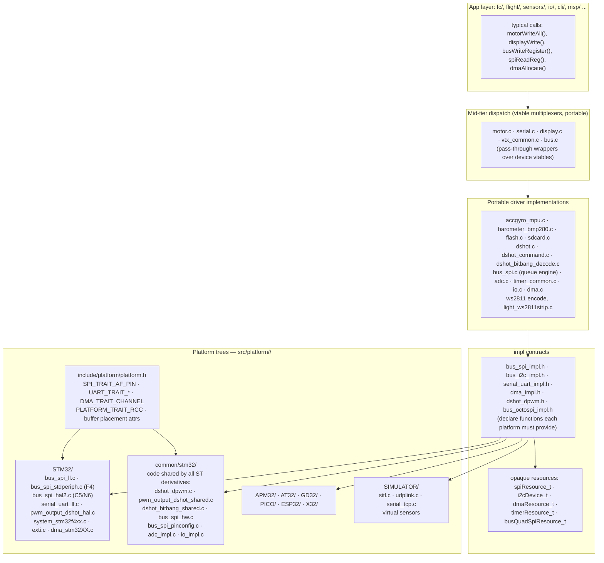
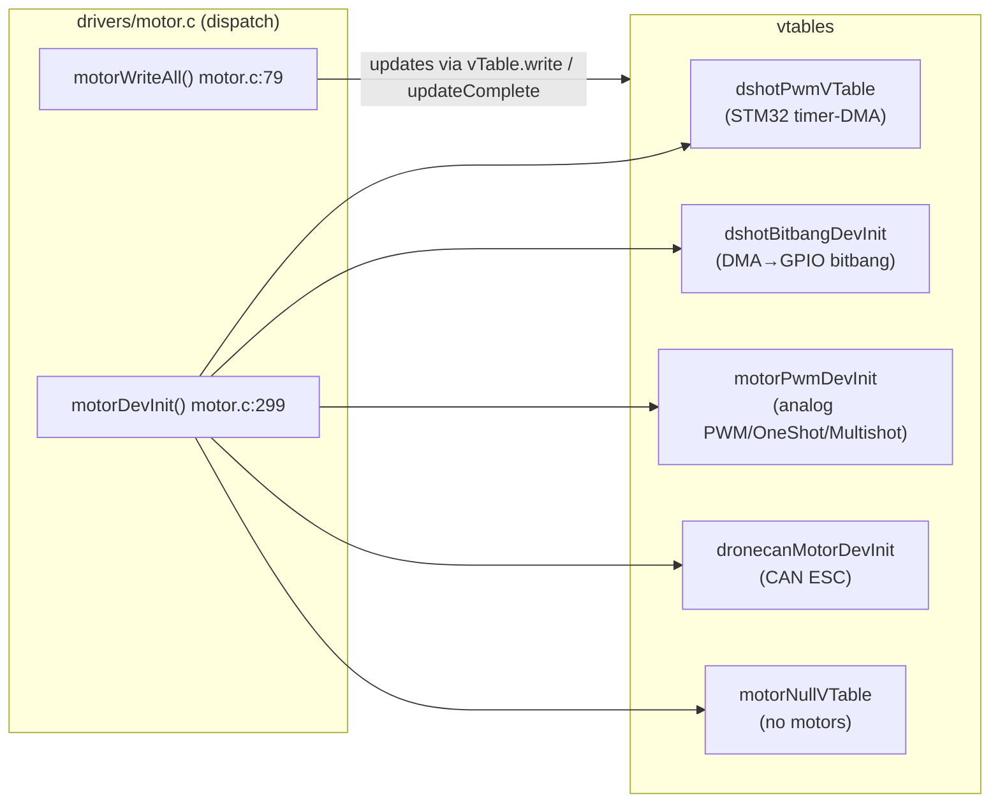
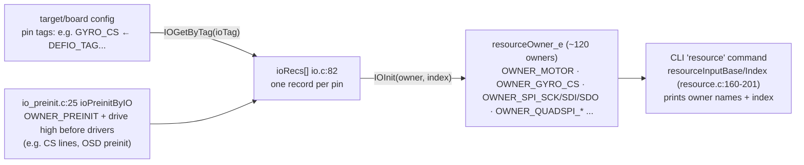
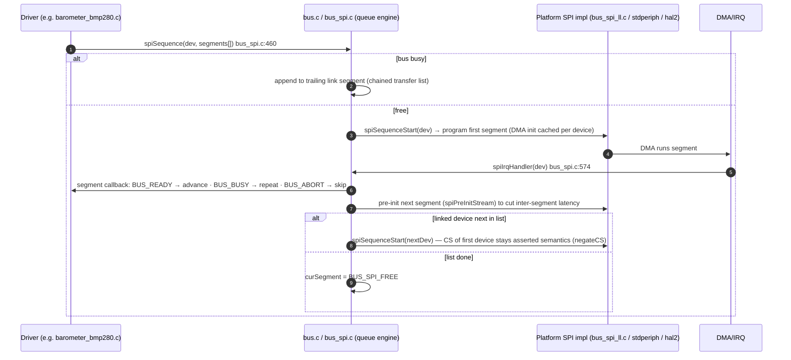
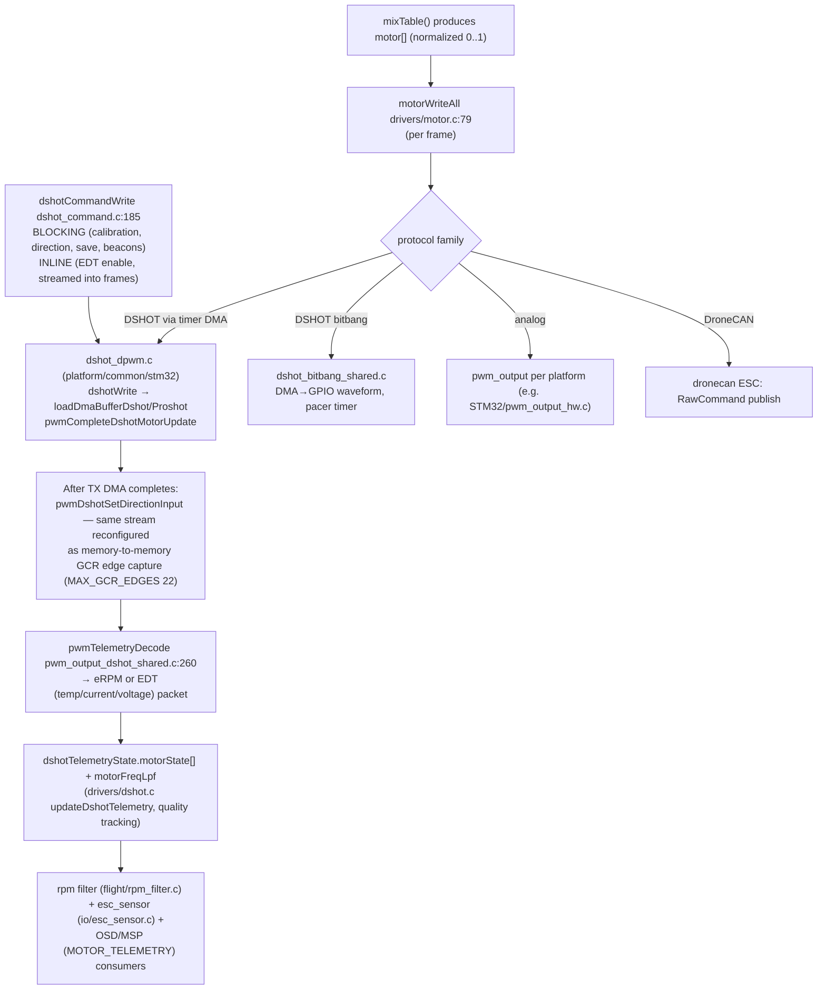

# 5. Drivers & Platform Abstraction

Files: [`src/main/drivers/`](https://github.com/betaflight/betaflight/tree/d593400a0/src/main/drivers) (~160 files), [`src/platform/`](https://github.com/betaflight/betaflight/tree/d593400a0/src/platform) (9 families).

## The one rule

> **Portable code in `src/main/` never includes a vendor SDK header.**

Peripheral handles are **opaque pointer types**; per-MCU knowledge flows in via *compile-time traits* and *per-platform implementation files* chosen by the build system.



Which actual `.c` files get compiled is decided **purely by the per-MCU `.mk` source lists** (e.g. `STM32/mk/STM32G4.mk` pulls `bus_spi_ll.c + pwm_output_dshot_hal.c`, while `STM32F4.mk` pulls `bus_spi_stdperiph.c + serial_uart_stm32f4xx.c`) — there is no `#ifdef` switching between competing implementations inside shared files; `USE_` macros and *trait* macros instead gate filler content inside shared code.

## The three flavors of "vtable"

### A. Runtime device vtables (most common)



`motorVTable_t` has 18 pointers (`motor_types.h:68-90`): `updateInit, write, writeInt, updateComplete, telemetryWait, decodeTelemetry, convertExternalToMotor, convertMotorToExternal, enable/disable, shutdown, isMotorIdle, getMotorIO…`. Same pattern for serial (`serialPortVTable` — 11 pointers, `serial_uart.c:565` fills `uartVTable`), display (`displayPortVTable_t`), VTX (`vtxVTable_s`), LCD panels, DroneCAN ESC.

### B. Per-instance function pointers (sensor style)

Older but still the pattern for sensors: shared structs expose `initFn/readFn` slots, each driver fills them:

```c
// drivers/accgyro/accgyro_spi_bmi270.c:569-582
acc->initFn = bmi270SpiAccInit;  acc->readFn = bmi270AccRead;
gyro->initFn = bmi270SpiGyroInit; gyro->readFn = bmi270GyroRead;
```

Same idea for `baroDev_t` (`drivers/barometer/barometer.h:33-46`) with its start_ut/read_ut/get_ut/start_up/read_up/get_up/calculate pipeline shaped around pressure & temperature read sequences.

### C. Compile-time "trait" polymorphism (per-MCU, zero overhead)

`platform/STM32/include/platform/platform.h:711-786` defines e.g. `SPI_TRAIT_AF_PIN`, `I2C_TRAIT_STATE`, `UART_TRAIT_*`, `DMA_TRAIT_CHANNEL/MUX`, `PLATFORM_TRAIT_RCC`, consumed by shared struct definitions in `*_impl.h` — templates without functions.

## IO, resources, and pin ownership

The key insight: **pins are owned**. Each physical pin is an `ioRec_t` in `ioRecs[]` (`drivers/io.c:82`); `IOInit(io, owner, index)` claims it:



- Timers: `timerAllocate(ioTag, owner, resourceIndex)` (`timer_common.c:112`) — configurable via the `timerio` PG (`USE_TIMER_MGMT`), with legacy auto-search fallback.
- DMA: one-shot claim via `dmaAllocate(identifier, owner, resourceIndex)` (`dma.c:26`); handlers installed later via `dmaSetHandler`. Request mapping tables live per-MCU (`platform/<FAM>/dma_reqmap_mcu.c`) and feed `dmaGetChannelSpecByPeripheral/ByTimer`; per-device `dmaopt` settings (PG) pin a specific mapping code.
- EXTI sharing: 16 EXTI lines each get one handler record; lines 5–9 (and 10–15 on some families) share an IRQ group whose NVIC priority is the **strictest requested** (`platform/STM32/exti.c:186-190`) — the mechanism that lets gyro + barometer-CS int + OSD chip int coexist.

## The bus subsystem (SPI/quad SPI/OCTOSPI/I2C)



- Transaction **segments** (`busSegment_t`) may hold buffers (`txData/rxData`), lengths with width nibbles, CS-negation flags, a per-segment callback, or a **link** to another device's segment list — enabling multi-device transaction chaining without CPU involvement between them.
- Polling path mirrors the same walk (`spiProcessSegmentsPolled`).
- High-level helpers `busWriteRegister / busReadRegisterBuffer(Start) / busBusy` (`drivers/bus.c`) adapt between SPI (0x7f/0x80 register bit, immediate completion + optional DMA) and I2C (async start/busy semantics), so sensor code is bus-agnostic.
- I2C has its own dev glue (`bus_i2c_busdev.c`) with blocking/async primitives and a soft-I2C bitbang option; QSPI/OCTOSPI exist for external flash (including **memory-mapped mode** used by MX66UW1G45G OPI flash for config-in-flash).

## DShot / motor output internals



Note the F4 errata workaround: DShot bitbang uses DMA2, so SPI DMA on DMA2 is disabled when bitbang is active (`bus_spi_hw.c:215-238`).

## Flash-backed abstractions

- `drivers/flash/flash.c`: NOR/NAND chips (m25p16/w25n/w25m/mt29f NAND/MX66UW1G45G OPI — over SPI/QSPI/OCTOSPI). Above it sits partitioning (`flash_partitionFindByType`) supporting **config-in-flash (EXST / CONFIG_IN_EXTERNAL or MEMORY_MAPPED_FLASH)** + BlackBox partition + Bootloader requests.
- `drivers/sdcard.c` + `sdcard_sdio_baremetal.c` + `sdcard_spi.c` + `sdcard_standard.c`: SD card front with a state machine (`SDCARD_STATE_*`), two transports (SDIO DMA / SPI). Used by config (`CONFIG.BIN`), BlackBox logging (FAT via `io/asyncfatfs`), MSC.

## Build-time wiring

MCU `.mk` files define `MCU_COMMON_SRC`, `DEVICE_STDPERIPH_SRC`, `VCP_SRC`, `STARTUP_SRC`, `LINKER_SCRIPT_SRC`, plus `TARGET_(HSE_MHZ|MCU|MCU_FAMILY)`. There is **no features.mk** — feature gating is by `USE_*` defines from target/board headers and `common_pre.h`/`common_defaults_post.h`, and at runtime by `featuresSupportedByBuild` (`config/feature.c:38`) so a feature configured by the user is rejected if its driver wasn't compiled in.
