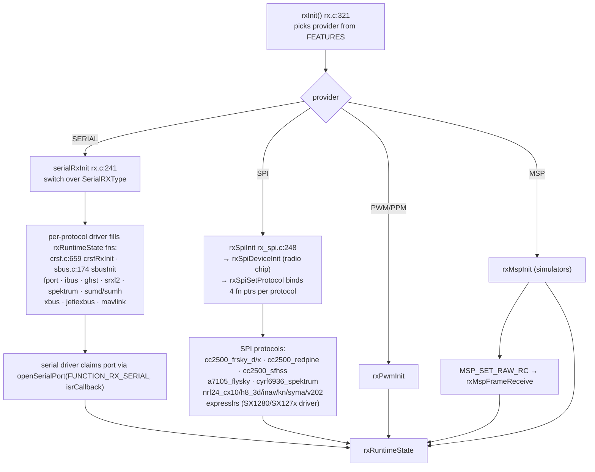
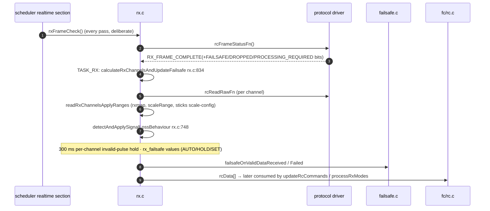
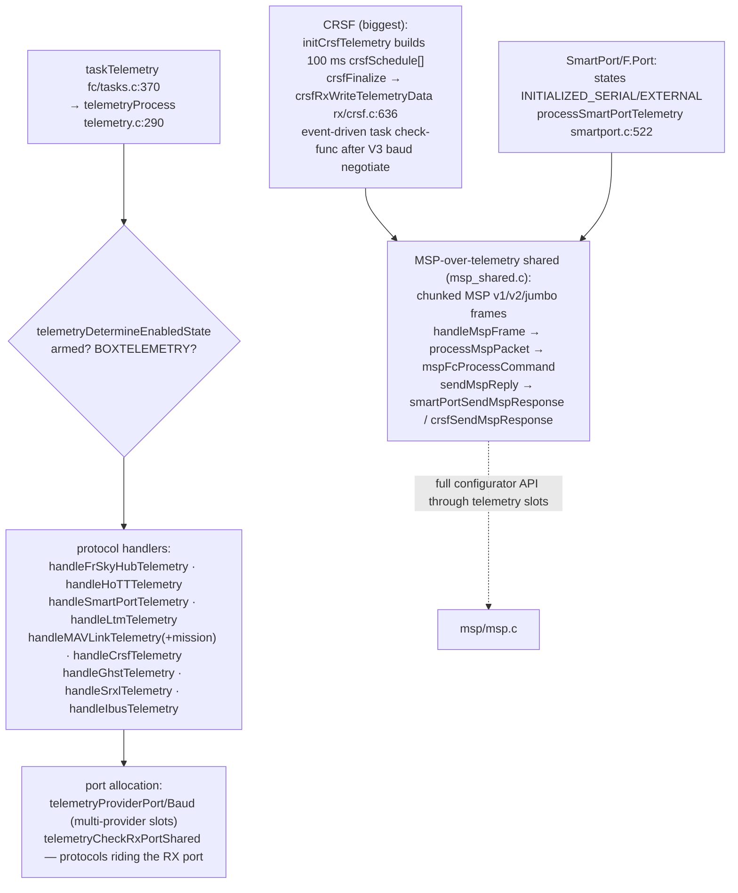
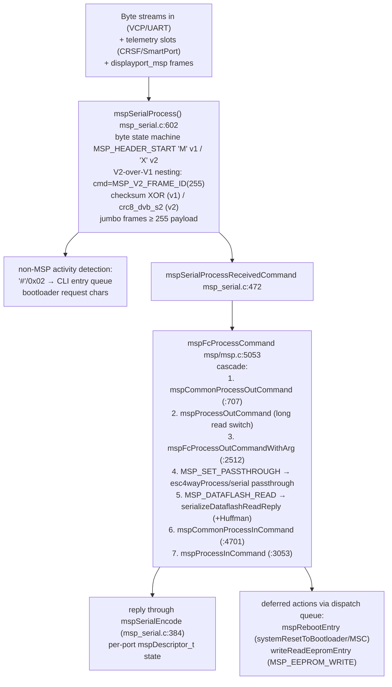
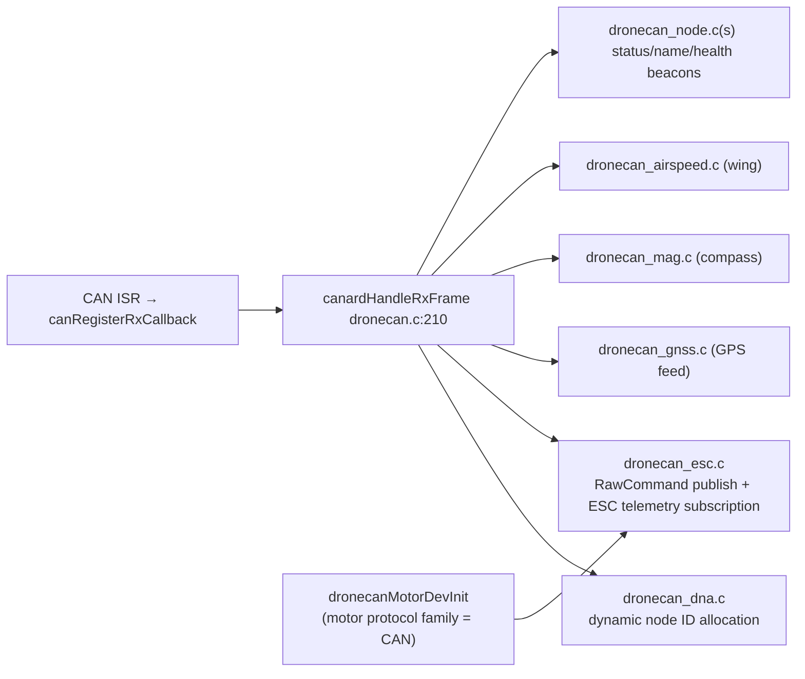
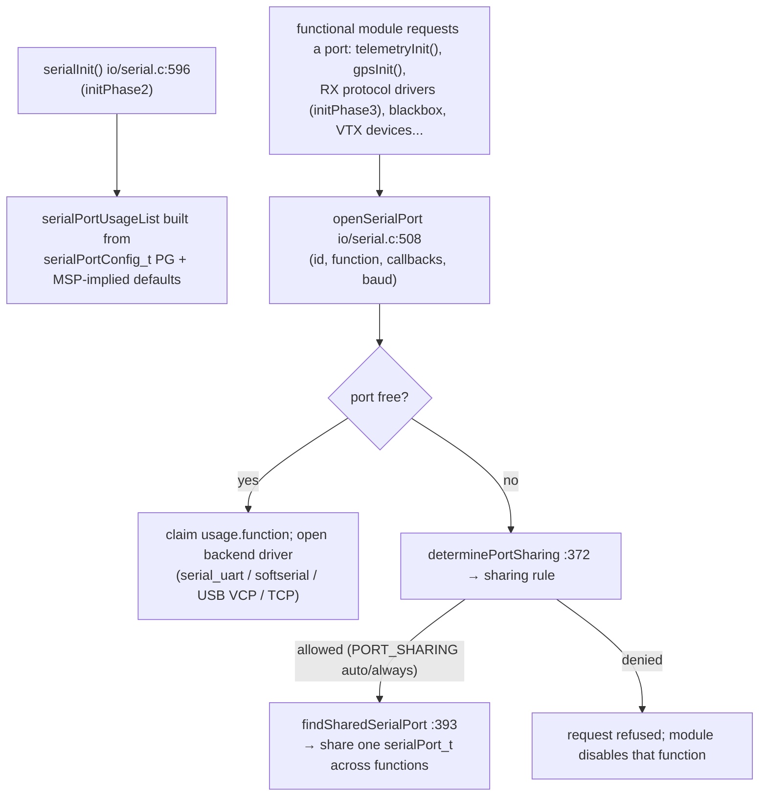

# 6. Communication Stack

Files: [`src/main/rx/`](https://github.com/betaflight/betaflight/tree/d593400a0/src/main/rx), [`src/main/telemetry/`](https://github.com/betaflight/betaflight/tree/d593400a0/src/main/telemetry), [`src/main/msp/`](https://github.com/betaflight/betaflight/tree/d593400a0/src/main/msp), [`src/main/io/gps.c`](https://github.com/betaflight/betaflight/blob/d593400a0/src/main/io/gps.c), [`src/main/io/dronecan/`](https://github.com/betaflight/betaflight/tree/d593400a0/src/main/io/dronecan).

## 1. RC input (`rx/`)

There is **no registration table** — one shared runtime struct (`rxRuntimeState`, rx/rx.c:141) is filled by whichever provider was chosen at init:

```c
typedef struct rxRuntimeState_s {
    rxProvider_e rxProvider;       // PWM | PPM | SERIAL | MSP | SPI | UDP
    SerialRXType serialrxProvider;
    uint16_t channelCount;
    rcReadRawDataFnPtr rcReadRawFn;        // per-channel read
    rxFrameStatusFnPtr rcFrameStatusFn;    // is a complete frame available?
    rxProcessFrameFnPtr rcProcessFrameFn;  // optional (simulators)
    uint16_t channelData[...]; scaleRange[...];
    timeUs_t lastRcFrameTimeUs;
} rxRuntimeState_t;
```



Frame processing loop (runs on `TASK_RX`, see [§3](./03-scheduler-realtime-loop.md#rx-scheduling-detail)):



Sync details worth knowing:

- `TASK_RX` check function `rxUpdateCheck` gives event-driven wakeups for protocols advertising frames.
- **Signal-loss policy**: per-channel hold for `MAX_INVALID_PULSE_TIME_MS` (300 ms), then switch to `rxFail` channel mode (AUTO/HOLD/SET) computed in `getRxfailValue`.
- **Link quality / RSSI**: sources evolve per protocol — `setRssi*` (ADC pin, RX_CHANNEL, per-protocol LQ such as CRSF LQ, GHST, MAVLink, or frame-error counting), smoothed by PT1; `rxGetLinkQuality()/rxGetRfMode()` consumed by OSD and telemetry.
- **Bind**: `startRxBind()` (`rx_bind.c:111`) dispatches to CRSF/SRXL2/SPI-family bind routines; exposed to CLI (`bind_rx`) and MSP button.
- ExpressLRS is special: phase-lock loop (`expresslrsUpdatePhaseShift`), connection state machine over SX1280/SX127x radio chips, telemetry piggybacked on uplink/downlink.
- **MSP override** (`rx/msp_override.c`): simulators can override real AUX channels from MSP (failsafe-for-lab-test semantics).

## 2. Telemetry (`telemetry/`)

One hub task (`TASK_TELEMETRY` 250/500 Hz) calls every compiled protocol's `handle*Telemetry()`; protocols are **pull/demand-slot** machines except where the frame format is push.



Key concepts:

- **Sensor enable mask** (`telemetryIsSensorEnabled`): per-protocol sensor allow-list (`sensor_e` bitmask `telemetry/telemetry.h:115`).
- **Port sharing**: specialty protocols (CRSF, GHST, SRXL2, F.Port telemetry half) ride the *RX* port (`telemetrySharedPort`); "slot" protocols (FRSKY_HUB, HOTT, SMARTPORT, LTM, MAVLINK, IBUS) claim dedicated ports via `providers[]` slots in the telemetry config PG.
- Supporting modules: `telemetry/mavlink_mission.c` (MAVLink waypoint/mission item streaming consumed by the wing flight-plan autopilot) and `telemetry/ibus_shared.c` (FlySky sensor-frame encoding shared with the ibus RX direction).
- EEPROM writes over a telemetry-linked MSP cause 5 request-skips (`TELEMETRY_REQUEST_SKIPS_AFTER_EEPROMWRITE`) so the write completes deterministically.

## 3. MSP (`msp/`) — the configurator protocol

MSP is the **external API of the firmware**, used by Betaflight Configurator, OSD-over-MSP (DJI/HDZero), VTX-over-MSP, telemetry-over-CRSF/SmartPort, and RC-simulator channel injection.



Notable handlers & cross-usage:

- `MSP_SET_RAW_RC` → RX_MSP provider feeding `rxDataProcessingRequired` (simulators).
- `MSP_OSD_*` — element positions, warnings, canvas, **font upload** (`MSP_OSD_CHAR_WRITE`, msp.c:4983–5050).
- `MSP_VTX_*_SETTINGS` back the VTX table PG used by CLI/CMS (`vtx_table`).
- Box names/modes (`msp_box.c initActiveBoxIds/serializeBoxNameFn`) power the mode-tab UI.
- `MSP_DATAFLASH_READ` streams blackbox logs (Huffman-compressed variant) off internal/external flash.
- Descriptor-level control: arming disable determined by MSP clients (`mspArmingDisableByDescriptor`), RX-SPI config only changeable over telemetry links.
- Wire constants live in `msp/msp_protocol.h` (v1 ids), `msp/msp_protocol_v2_common.h`, and `msp/msp_protocol_v2_betaflight.h` (Betaflight-specific v2 ids); build metadata served by `msp/msp_build_info.c`.

## 4. GPS

`io/gps.c` (3.1k LoC) with inlined protocol parsers (uBX binary, NMEA, and PAPPRC/DAC/RTC118 variants):

- `gpsInit()` — baud/provider sweep, `gpsUpdate()` on TASK_GPS
- State into `gpsSol`, fixes into `stateFlags` (`GPS_FIX`, `GPS_FIX_HOME`), home distance/heading consumed by GPS rescue and OSD modules
- SITL: `io/gps_virtual.c` fed from the simulator link

## 5. DroneCAN

`io/dronecan/` implements the DroneCAN app layer over libcanard (submodule) + `drivers/can/`:



## 6. GPS loop command summary (what talks to what)

| Channel | Direction | Carrier | Purpose |
|---|---|---|---|
| RC control | in | CRSF/SBUS/ELRS/SPI radio... | setpoints, modes, arming |
| Telemetry | out (+in for CRSF) | CRSF/SmartPort/MAVLink/LTM/HoTT/IBUS/GHST | battery, attitude, GPS, LQ |
| MSP | in/out | serial (VCP/UART), telemetry slots, OSD/VTX | config, status, logs, OSD text |
| MAVLink | in/out | Mavlink protocol + mission items | autopilot mission + telemetry |
| DroneCAN | in/out | CAN (libcanard) | ESC command/telemetry, GNSS, MAG, airspeed |
| GPS | in | UART | positioning |
| Serial passthrough | in/out | UART | ESC flashing (4-way), console apps, device protocols |

## 7. Serial port allocation (`io/serial.c`)

Every subsystem that wants a UART (MSP, telemetry, RX, GPS, blackbox, ESC passthrough, VTX…) claims ports through one mechanism so conflicting users are detected:

- `serialPortFunction_e` (io/serial.h:56): the ~20 possible functions a port may serve (`FUNCTION_MSP`, `FUNCTION_RX_SERIAL`, `FUNCTION_TELEMETRY_*`, `FUNCTION_GPS`, `FUNCTION_BLACKBOX`, `FUNCTION_VTX_SMARTAUDIO`, …).
- `serialPortConfig_t` PG: persisted "which functions live on which identifier" — written by CLI `serial` / Configurator.
- `serialPortUsage_t` table (io/serial.h:162): runtime claim of each identifier by function + open `serialPort_t`.



Conventions worth internalizing:

- **VCP is almost always MSP** (USB configurator); free UARTs get GPS/telemetry/blackbox from the user's port settings.
- CRSF/GHST/SRXL2 telemetry preferentially **rides the RX port**; "slot" telemetry protocols (FrSky hub, HoTT, LTM, MAVLink, IBUS) claim dedicated ports via the telemetry provider slots (see §2).
- Modules that only need borrowed bytes (ESC 4-way passthrough, OSD/VTX-over-MSP) don't claim ports — they reuse an existing `serialPort_t` via MSP passthrough hooks (`mspFcSetPassthroughCommand` → `esc4wayProcess`).
