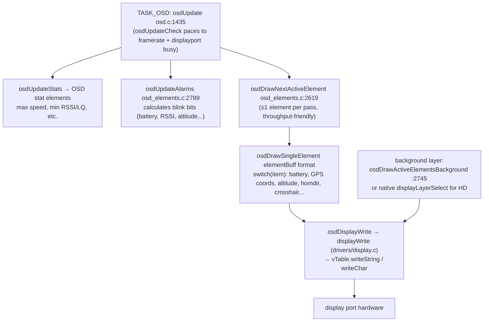
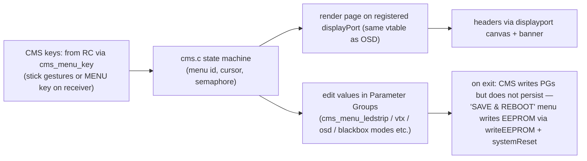
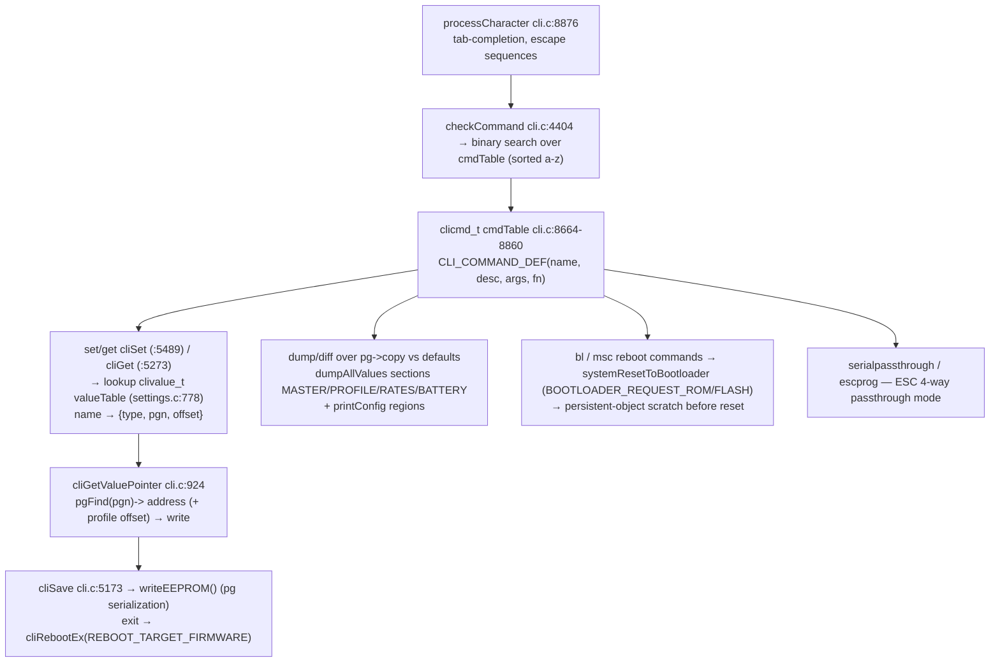
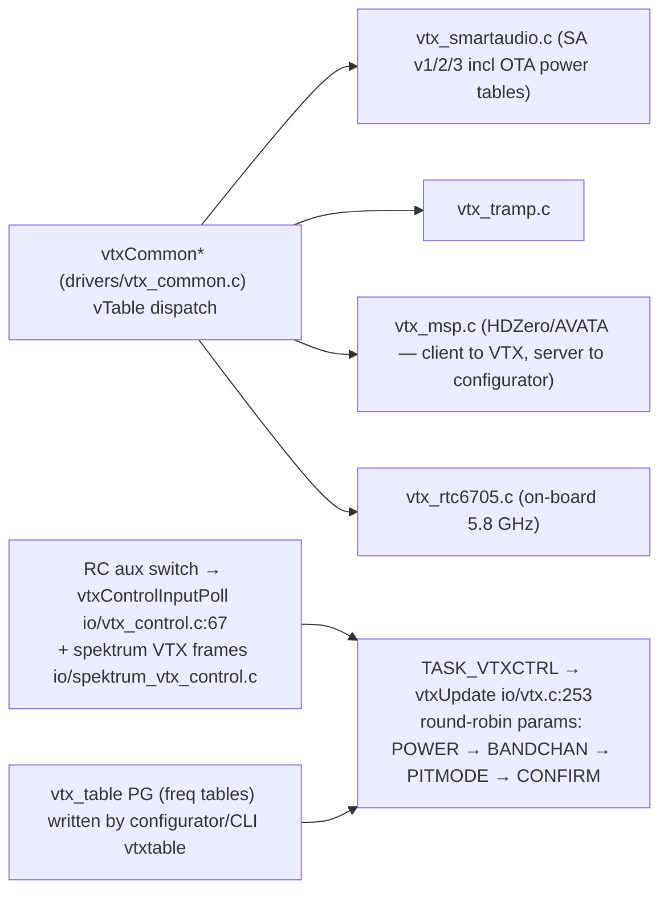

# 7. User Interfaces

Files: [`src/main/osd/`](https://github.com/betaflight/betaflight/tree/d593400a0/src/main/osd), [`src/main/cms/`](https://github.com/betaflight/betaflight/tree/d593400a0/src/main/cms), [`src/main/cli/`](https://github.com/betaflight/betaflight/tree/d593400a0/src/main/cli), [`src/main/io/vtx*.c`](https://github.com/betaflight/betaflight/tree/d593400a0/src/main/io), [`src/main/io/ledstrip.c`](https://github.com/betaflight/betaflight/blob/d593400a0/src/main/io/ledstrip.c), [`src/main/io/beeper.c`](https://github.com/betaflight/betaflight/blob/d593400a0/src/main/io/beeper.c).

## 1. OSD + display ports

The OSD engine is **display-agnostic**: it renders a text grid (optionally pixel canvas for HD format) through the `displayPortVTable` abstraction.

**Available display ports** (`io/displayport_*.c`):

| Port | Transport | Used by |
|---|---|---|
| `max7456` | SPI chip (AT7456E/MAX7456) | classic analog VTX OSD, fonts uploadable |
| `msp` | serial (OSD-over-MSP for DJI / HDZero goggles) | HD FPV |
| `fb_osd` | framebuffer (internal pixel OSD) | HDZero appeals format |
| `frsky_osd` | UART protocol | FrSky OSD (with pixel canvas `getCanvas`) |
| `crsf` | CRSF/ELRS link | phone/LUA screen sharing (ELRS) |
| `srxl2` | UART text | Spektrum SRXL2 |
| `hott` | UART text | HoTT |
| `oled` | I2C SSD1306 (dashboard task) | legacy dashboards, not via OSD path |

Selection at boot is a fallback chain (see [§2 boot](./02-boot-and-startup.md#osd-displayport-fallback-chain)); CMS registers with the same display port.



Element **positions** come from the `osdElementConfig` PG (`item_pos[]`), editable via CLI (`osd_layout`-style) and via MSP (`MSP_SET_OSD_CONFIG` + re-analysis). The active element list is built by `osdAnalyzeActiveElements` (osd.c:333) skipping background/co-located ones.

Warnings: `osd/osd_warnings.c renderOsdWarning (:174)` — arming disable reasons (`getArmingDisableFlagNames`), failsafe flashes, battery/RSSI/cell warnings, ESC telemetry warnings (`buildEscWarningMessage`).

Custom text & map: `osd/osd_custom_text.c`, `osd/osd_nav_map.c` (frame-based autonomous map renderer).

## 2. CMS (Canvas Menu System)

`cms/cms.c` + per-menu `cms_menu_*.c` files. Menu navigation is behavior-driven from RC sticks or a gyro-less key device:



All menus use either direct `pg*Mutable(…)->field = value` (simple) or dedicated handler functions where validation is required (VTX band/channel indices, OSD element positions, blackbox device selection).

The menu tree (`cms_menu_*.c`):

| Area | Menus |
|---|---|
| Setup | `cms_menu_main` (front page: profiles, craft name), `cms_menu_saveexit` (SAVE/EXIT/EXIT-NO-SAVE) |
| Tuning | `cms_menu_imu` (PID/rates/filters), `cms_menu_power` (battery profile/ATX), `cms_menu_rpm_limit`, `cms_menu_quick` (slider-style quick tune) |
| Flight | `cms_menu_failsafe`, `cms_menu_gps_rescue_multirotor` / `_wing`, `cms_menu_gps_lap_timer` |
| Peripherals | `cms_menu_ledstrip`, `cms_menu_vtx_common` + per-device `_smartaudio`/`_tramp`/`_rtc6705`/`_msp`, `cms_menu_blackbox` (device + erase + MSC) |
| Display | `cms_menu_osd` (element toggles/positions) |
| Data | `cms_menu_firmware` (build info), `cms_menu_persistent_stats` (flight statistics) |
| Generic | `cms_menu_misc` (features, escapable lists) |

## 3. Auxiliary IO devices

A set of small, self-contained io/ modules that don't fit the big blocks above, each driven by its own task or by TX-side protocols:

| Module | Transport | Notes |
|---|---|---|
| `io/transponder_ir.c` + `_arcitimer/_ilap/_erlt` | timer-DMA IR LED | race-track transponder protocols (Arcitimer / iLap / ERLT), `TASK_TRANSPONDER` |
| `io/camera_control.c` | GPIO/DAC/PWM/serial | camera feature enable/notification via resistor ladder or serial packets, `TASK_CAMCTRL` |
| `io/rcdevice.c` + `rcdevice_cam.c` | RX-protocol-over-AUX serial (Runcam protocol) | RunCam Split device control; `TASK_RCDEVICE` |
| `io/gimbal_control.c` | dedicated gimbal protocol | servo gimbal control for fixed mounts |
| `io/piniobox.c` | pinio PG channels | maps flight boxes to config-owned GPIO pins; `TASK_PINIOBOX` spells the `PINIOBOX` MSP status |
| `io/pidaudio.c` | PWM tone via `drivers/audio` | `BOXPIDAUDIO` toggles audible feedback: `pidAudioUpdate` maps `pidData[roll/pitch].Sum` to a tone (`PID_AUDIO_PIDSUM_X/Y/XY` modes) |
| `io/spektrum_rssi.c` | DSM uart bytes | RSSI squeezed out of Spektrum telemetry streams |
| `io/usb_cdc_hid.c` | USB HID | joystick/VCP-composite HID device |
| `io/serial_lcd_console.c` + `drivers/lcd_console.c` + `lcd_panel/` | I2C/SPI LCDs | text console onto tft/oled panels (incl. `ssd1306_i2c`), used by `dashboard` and LCD-console feature |
| `io/serial_4way.c` + `_stk500v2` + `_avrootloader` | serial passthrough | BLHeli/atmel ESC flashing protocol stack — reached via `MSP_SET_PASSTHROUGH` |
| `io/serial_feature_map.c`, `io/serial_resource.c` | — | serial function synthesis & one-MSP-resource helpers consumed by `MSP_SET_*`/CLI |
| `io/statusindicator.c` | IO pin | simple arming status LED strip on the target config |

## 4. CLI

`cli/cli.c` (9.4k LoC — the largest file in the tree) + `cli/settings.c` (2.3k LoC). Entry paths: MSP-detected `#`/0x02 (`msp/msp_serial.c:625`), CLI serial port claimed via `cliEnter(serialPort, interactive)`, or batch config-file replay `cliProcessConfigFile` (used by SITL and copy-from-board flows).



The settings engine is the bridge to PG:

```
clivalue_t { name, type (VAR_UINT/INT/STRING/BITSET/LOOKUP/ARRAY),
             config (min/max or table idx), pgn, offsetof(T, field) }
```

`getValueOffset` (cli.c:909) adds `sizeof(pidProfile_t) * getPidProfileIndexToUse()` (and analogous offsets for rate profiles and battery profiles) so `set p_roll` writes the *currently selected profile's* copy — see [§9 Configuration System](./09-configuration-system.md).

Commands of note for contributors: `status`, `tasks` (per-task CPU stats from the scheduler), `sensors`, `peripherals`, `flash_info`, `sd_info`, `dma`, `timer`, `resource` (shows pin owners — the mappings described in [§5](./05-drivers-platform.md#io-resources-and-pin-ownership)), `rc_stats`, `gyro_debug/rpm_filter` debug groups.

## 5. VTX control



Only retried while disarmed/pending (`vtxUpdate` gate `:294`); CMS menus per device; OSD shows the VTX element from `vtxCommonDeviceStatus`.

## 6. LED strip

`io/ledstrip.c` (1.65k LoC) on TASK_LEDSTRIP:

- **status mode chain** (`applyStatusModeUpdate`): battery color → errors (arming disable flags flash) → GPS → RSSI → larson scanner (`MODE Rainbow`) → beacon → throttle overlay
- **LED config PG** per LED: `color`, `function`, `overlay`, `coordinates` — parsed from CLI `led`/`color`/`mode_color` commands into `ledConfig_t`
- encoding: `ws2811UpdateStrip` (`drivers/light_ws2811strip.c:131`) → platform DMA/timer senders (`light_ws2811strip_hal.c`/`_stdperiph`/`_pico`/`_esp32`)
- disable via BOXLEDLOW when disarmed or by feature

## 7. Beeper

`io/beeper.c` (629 LoC) — pattern table `beeperTable[]` (:225) with silencing logic:

- mode set by calls all over the tree: `BEEPER_GYRO_CALIBRATED`, `BEEPER_RX_LOST`, `BEEPER_BATTERY_CRITICAL`, `BEEPER_ARMING`, `BEEPER_MULTI_BEEPS` for custom patterns
- mute while configurator active (`mspSerialIsConfiguratorActive`) or in CLI
- output to virtual beepers (OSD/simulator) or IO pins, plus **DSHOT beacons** (`BEEPER_*` commands via `dshot_command` — treated as motor protocol commands, not IO)
