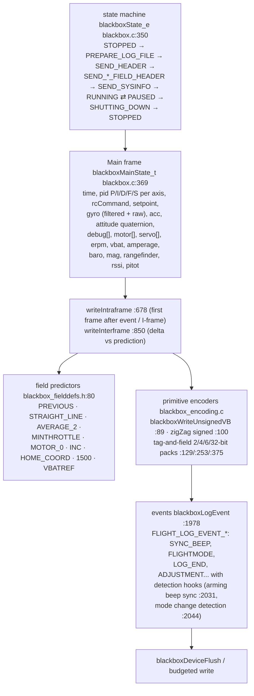
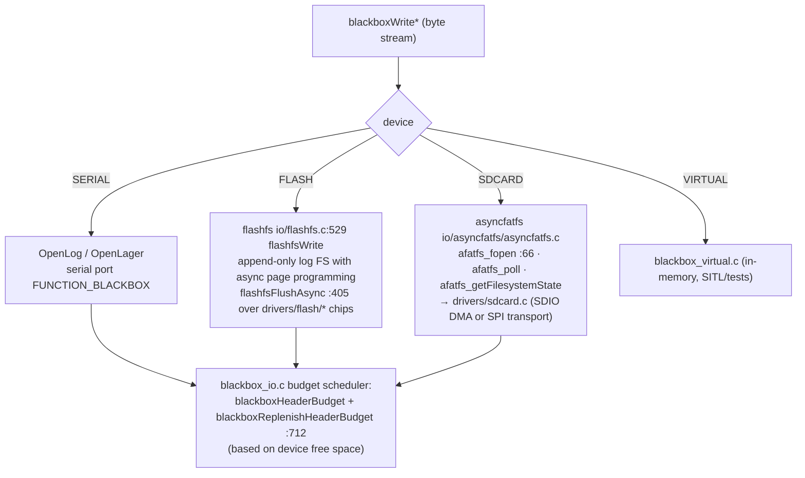
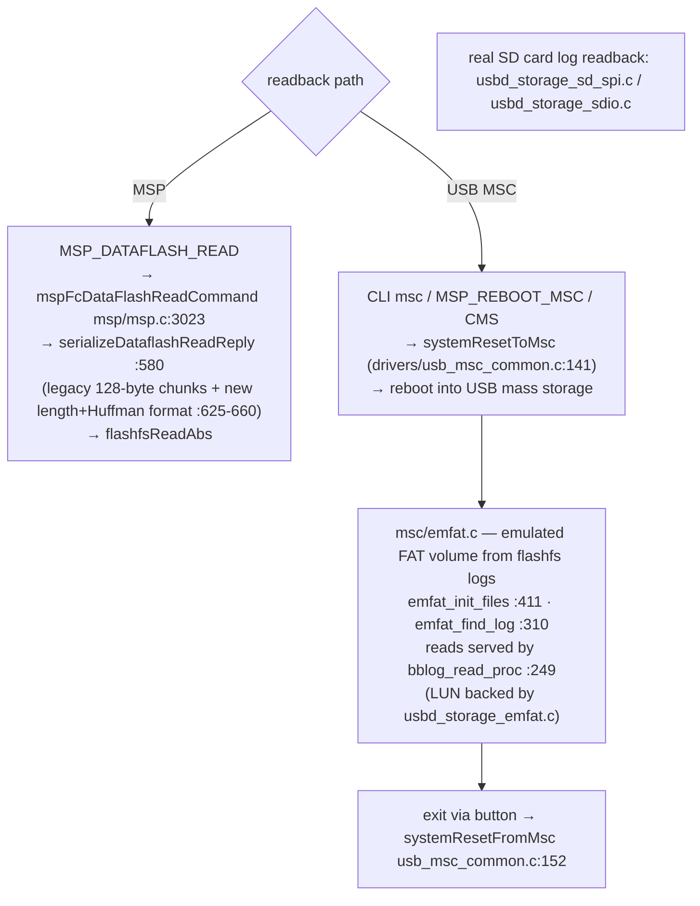

# 8. Blackbox & Storage

Files: [`src/main/blackbox/`](https://github.com/betaflight/betaflight/tree/d593400a0/src/main/blackbox), [`src/main/io/flashfs.c`](https://github.com/betaflight/betaflight/blob/d593400a0/src/main/io/flashfs.c), [`src/main/io/asyncfatfs/`](https://github.com/betaflight/betaflight/tree/d593400a0/src/main/io/asyncfatfs), [`src/main/msc/`](https://github.com/betaflight/betaflight/tree/d593400a0/src/main/msc).

Blackbox runs **inside the PID loop** — `blackboxUpdate(currentTimeUs)` is called from `subTaskPidSubprocesses` (`fc/core.c:1479`), meaning logging content is written exactly in sync with the control loop with a per-loop byte budget (`blackboxHeaderBudget`, refilled from device free-space).

## Frame format

Encoder design: **intra + inter frames with per-field predictors**, then variable-byte / zigzag / tag packing.

Field presence adapts: `flightLogFieldCondition_e` (motors present? RC logged? debug columns? RPM telemetry available?...) — a log from a 4-motor DShot bidir config has a different schema than a wing with GPS.

## Storage backends

One recorder, three media — decided in `blackboxDeviceOpen` (`blackbox_io.c:309`) based on `blackboxConfig()->device`:

- `TASK_MAIN` (fc/tasks.c:129) continuously polls `afatfs_poll()` and `flashfsEraseAsync()` so page ops never block the control loop.
- Flush strategy: `blackboxDeviceFlush` (`:222`) when budget allows; `blackboxDeviceFlushForce` (`:250`) at disarm (`blackboxFinish`).

## Reading logs back

The **emfat trick** is worth appreciating: the FC has no FAT *writer* for NOR flash (flashfs is append-only), so instead of teaching the host how to read flashfs, the firmware *emulates* a FAT drive whose files are synthesized on the fly from flashfs content — one USB drawer, log files appear as normal `.bbl`.

## What gets logged — and when not

- `blackboxConfig()->p_denom / p_ratio` control the PID-loop logging denominator; the log starts at arm (`blackboxSetState` transitions + disarm event reasons from `flightLogDisarmReason_e` core.h:44-60).
- Headers are rate-limited (`blackboxHeaderBudget`) because extremely large headers on SD would starve the loop; `blackboxReplenishHeaderBudget` recovers space-aware budgets for serial/flash/SD devices.
- MSP can also read `MSP_ANALOG`-style live data; blackbox is strictly offline-ish (except via virtual device in tests).
- Debug modes: `debug_mode` selects which DEBUG_* slice gets logged into `debug[]`; the same slice also feeds OSD/telemetry (`sensors/gyro.c` DEBUG_GYRO_RAW, `adcinternal` DEBUG slots...).
