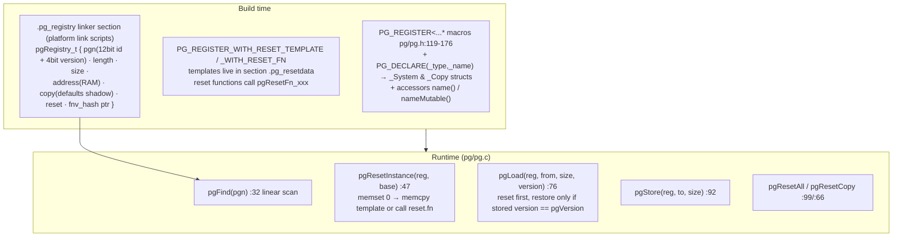
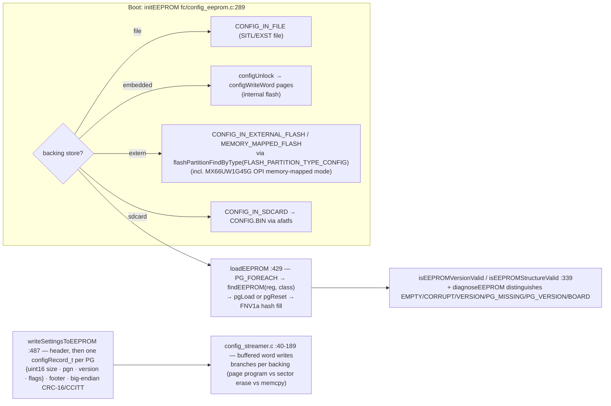
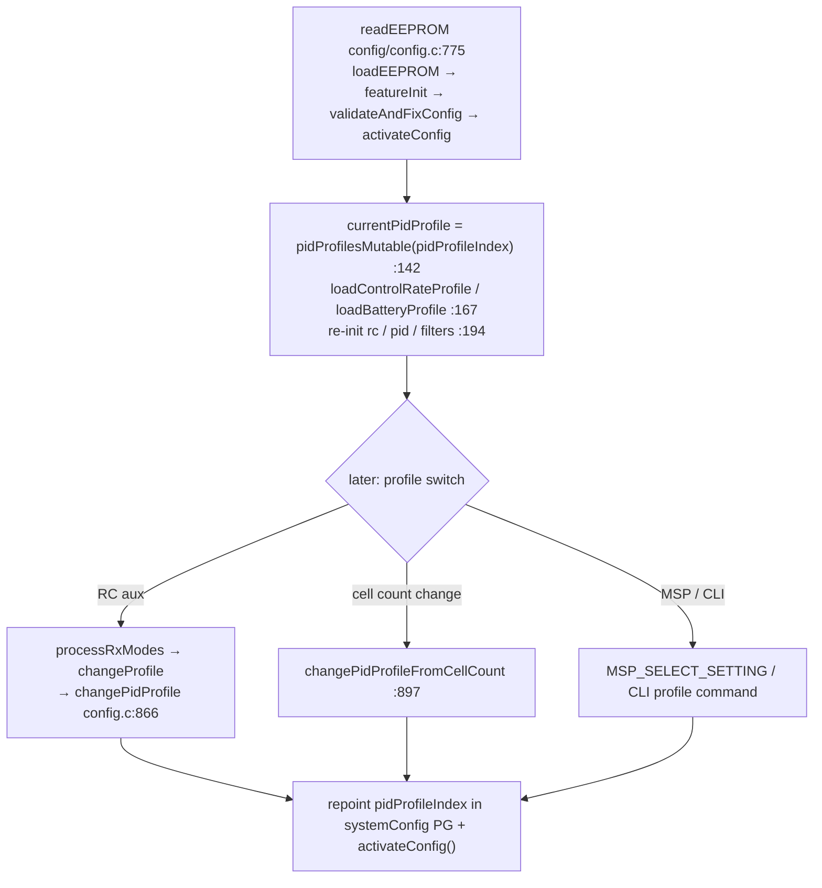
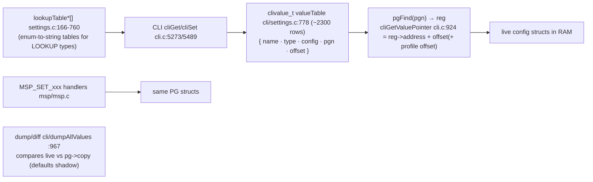

# 9. Configuration System

Files: [`src/main/pg/`](../betaflight/src/main/pg), [`src/main/config/`](../betaflight/src/main/config), [`src/main/cli/settings.c`](../betaflight/src/main/cli/settings.c).

Every persisted setting in Betaflight is a **Parameter Group (PG)**: a struct registered into a linker section at build time. EEPROM persistence, CLI dump, and MSP all operate on the same structs — there is no duplicated configuration model.

## The PG registry

Key macros and their meanings:

| Macro | Meaning |
|---|---|
| `PG_REGISTER(type, name, pgn, version)` | simple no-reset PG |
| `PG_REGISTER_WITH_RESET_FN(type, name, pgn, version)` | provides `pgResetFn_##name()` |
| `PG_REGISTER_WITH_RESET_TEMPLATE(...)` + `PG_RESET_TEMPLATE` | defaults are a literal struct blob in `.pg_resetdata` |
| `PG_REGISTER_ARRAY[_WITH_RESET_FN](type, count, name, pgn, version)` | per-instance array (profiles, serial ports, gyro devices…) |
| `PG_DECLARE_ARRAY(_type, maxLength, name)` | array accessors `name(i)`/`nameMutable(i)` |

PG IDs are a **hand-maintained registry** in [`pg/pg_ids.h`](../betaflight/src/main/pg/pg_ids.h): `PG_FAILSAFE_CONFIG 1`, `PG_MOTOR_CONFIG 6`, `PG_PID_PROFILE 14`, `PG_SYSTEM_CONFIG 18`, `PG_FEATURE_CONFIG 19`, `PG_RX_CONFIG 24`, … They are part of the **on-flash format contract** and are checked for uniqueness ordering by a unit test (`src/test/unit/check_pg_ids.awk` wired into `make test`).

The **4-bit version** stored in the id's top bits drives migration: on EEPROM load, a PG whose stored version ≠ current is dropped to defaults rather than misread — this is how fields get added/removed safely without config breaks.

## EEPROM persistence

- The **FNV-1a hash** per PG (filled by `pgLoad`, compared in `writeSettingsToEEPROM`) is the dirty-detection mechanism: unchanged PGs skip their EEPROM re-erase.
- `_SYSTEM` record-class flags (`CR_CLASSICATION_MASK=0x3`) are legacy; profiles are stored as *big array PGs* (`PID_PROFILE_COUNT 4`, `CONTROL_RATE_PROFILE_COUNT`, `BATTERY_PROFILE_COUNT 3` — from `common_pre.h:355-359`).

## Profile activation & runtime switching

**Profile indirection lives at the CLI/MSP layer, not the PG layer**: `clivalue_t` rows declare `PROFILE_VALUE / PROFILE_RATE_VALUE / PROFILE_BATTERY_VALUE` flags; `getValueOffset` (`cli/cli.c:909`) adds `sizeof(pidProfile_t) * getPidProfileIndexToUse()` to reach the selected profile's copy of the struct.

## Features

`config/feature.c`:

- `featureConfig` PG stores a bitmask of *desired* features.
- `featuresSupportedByBuild` (:38-102) is the **build-time capability mask** — a feature may only be *configured* if its `USE_*` driver was compiled in (checked in `featureEnableImmediate` and CLI validation).
- Defaults: `DEFAULT_FEATURES | DEFAULT_RX_FEATURE | FEATURE_ANTI_GRAVITY | FEATURE_AIRMODE`.

### Tuning sliders (`config/simplified_tuning.c`)

With `USE_SIMPLIFIED_TUNING`, the Configurator's "Tuning" sliders (master gain, expo, D/D-Max, dynamic filter level, …) map to concrete setting values through `calculateNewPidValues()`/`calculateNewDTermFilterValues()`/`calculateNewGyroFilterValues()` in this module: it starts from the in-code defaults and scales the profile fields for each axis — a bidirectional bridge, so CLI `dump` still shows real PID/rate numbers. The slider *state* (which sliders are enabled + their values) is part of the pidProfile PG.

## CLI/MSP binding (the settings engine)

Note the three *views* over one data model:

1. **CLI** (text names) → `clivalue_t` → PG structs
2. **MSP** (numeric per-field setter commands, generated tables) → same PG structs
3. **EEPROM** (schema binary) → same PG structs (versioned)

## Where target/board-level config lives

- `targetConfiguration()` / `configTargetPreInit()` (declared `config/config.h:100-102`, called from `fc/init.c:305-312`) are hooks provided by the board's optional `config.c` in the `src/config` submodule — the mechanism for board-specific peripheral banks (e.g. assigning OSD SPI to SPI3, ADC channels, gyro devices).
- Defaults fixed at build time come from `target/common_pre.h` (feature gates, counts) and `common_defaults_post.h` (per-family hardware defaults such as `RX_MIN_USEC/RX_MAX_USEC`, I2C bus speeds, USB MSC button pins).

## Unit test hooks

- `src/test/unit/check_pg_ids.awk` — id registry consistency check
- gtest suites exercise PG scaling, EEPROM serialization (`unittest` C harnesses via `unittest_c.c`), and virtual blackbox device (`blackbox_virtual.c`)
