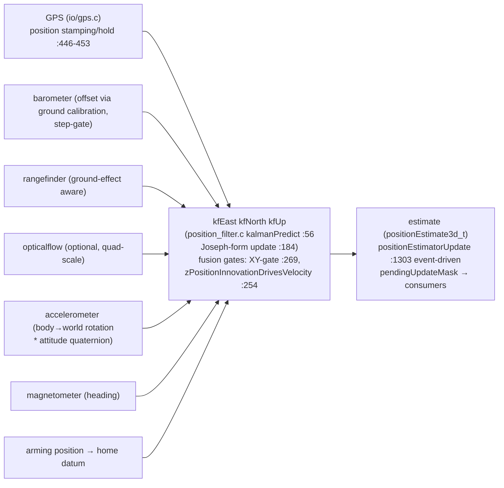
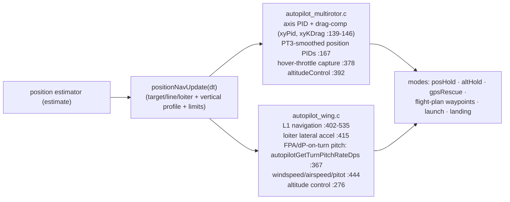
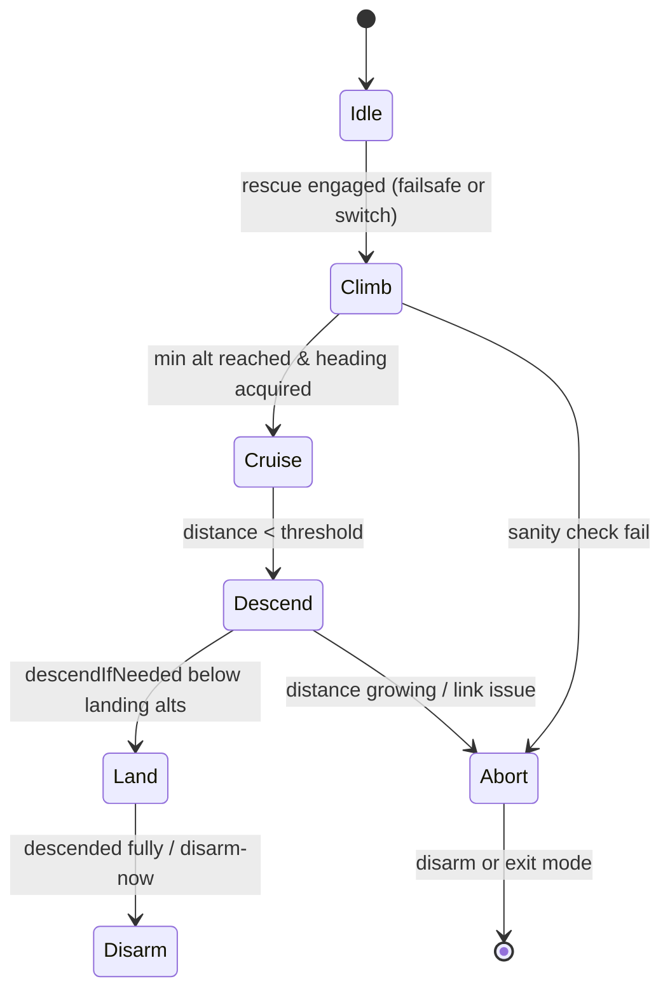
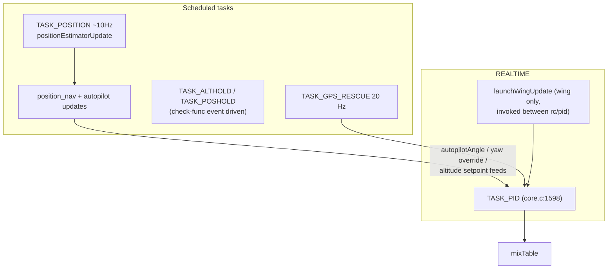

# 10. Navigation & Autopilot

Files: [`src/main/flight/position_estimator.c`](../betaflight/src/main/flight/position_estimator.c), `position_filter.c`, `position_nav.c`, `autopilot_multirotor.c`, `autopilot_wing.c`, `gps_rescue_multirotor.c`, `gps_rescue_wing.c`, `pos_hold_multirotor.c`, `pos_hold_wing.c`, `alt_hold_multirotor.c`, `alt_hold_wing.c`, `launch_wing.c`, `landing_wing.c`, `flight_plan_nav.c`, `nav_trail.c`, `flight_plan_capture.c`.

Betaflight has real **navigation** (estimator + controller) on both multirotor and wing frames. The design principle: estimation and navigation are **frame-sharing layers** (shared `position_estimator`/`position_nav`), while **mode controllers** (pos hold, alt hold, GPS rescue, launch, landing) come in `_multirotor` / `_wing` pairs whose inner loops differ fundamentally (lateral velocity PID mapping to pitch/roll vs. L1 lateral acceleration → bank).

## Position estimation

`flight/position_estimator.c` (1.5k LoC) — a lightweight **jerk-model Kalman filter** (3 independent KFs for East/North/Up) from `position_filter.c`:

- Per-axis **z-calibration table** (`zCal`, :443) and GPS-altitude policy (:223) control fusion aggressiveness.
- Resets: `positionEstimatorResetZ` (:1481) / `ResetXY` (:1516) on arming, GPS-fix-home acquisition, estimator divergence.
- Consumers notified with a publish mask (`positionEstimatorConsumer_e` :438) — pos hold, alt hold, autopilot, rescue, geofence.

## Shared navigation layer

`flight/position_nav.c` implements the frame-independent target-tracking core that both classes consume: target management (`positionNavSetTargetEf` :76 / MoveTargetEf), track-line & loiter kinematics (:160/:168), vertical profile + ramp (:225/:302), acceleration limits (:242), velocity feedforward (:248), approach braking (:262), arrival requirements (:280), settle timeout (:285), max-angle cap (:290). The core update step is `positionNavUpdate(dt, est)` :332.

## GPS rescue (multirotor)

`gps_rescue_multirotor.c` — rescue is an **autopilot mission** both core.c rules and wing rules use (BOXGPSRESCUE staged, core.c:1160-1202):

- `gpsRescueUpdate` (:522) called at `TASK_GPS_RESCUE_RATE_HZ`
- sanity checks (:278: minimum satellite fix, distance/altitude sanity, disarm-if-impossible)
- yaw/velocity/altitude controllers with startup attenuators (:206-216) and min-landing descent (`descend` :456, `descendIfNeeded` :464, emergency descent :267, disarm-now :259)
- Interaction from failsafe: `failsafeStageRescueAtMissionEnd` wires rescue into `failsafeUpdateState` (see [§4](./04-flight-control-pipeline.md#failsafe))

## Flight plan — waypoint missions (wings, with capture)

- `flight_plan_nav.c` (2.7k) is the frame-agnostic mission runtime: waypoint lists, durations/events, geofence, and a **capture mode** (`flight_plan_capture.c`) that records live flight as a flight plan for later execution (RTL / repeat from home).
- Wing-side: `flight_plan_nav_wing.c`, plus `launch_wing.c` (557 LoC — arm while holding wings level and climbing) and `landing_wing.c` (983 LoC — flare-based landing control).
- The multirotor autopilot surface in `autopilot_multirotor.c` is hold-oriented (position/altitude hold, GPS rescue); full waypoint mission flying is currently tailored to the wing classes.

## Launch control (multirotor-level, wing-class)

- `launchWingUpdate` (`launch_wing.c`) is invoked in the realtime section **between RC command and PID controller** (core.c:1613-1617) so launch position holding has the exact same loop rate as the controller:
  - arm/disarm hooks (core.c:593/704), I-term reset at launch (core.c:926)
- Multirotor "launch control" (from earlier releases) is beep-count based (armed-count beep) — no wing lumping.

## How it all pieces together per pass

Mode logic is *stateful and cross-cut*: `posHoldUpdateCheck` (pos_hold_multirotor.c:91) decides sensor gating and stick-override interruptions (control handback logic :159-170); `failsafeUpdateState` may activate rescue autonomously; and `gpsRescue`/`posHold`/`altHold` are exclusive as `flightModeFlags`.
