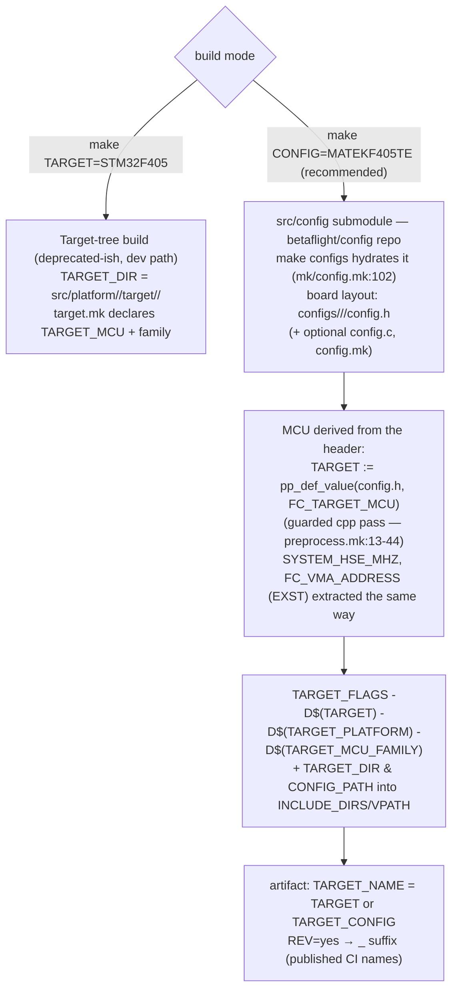
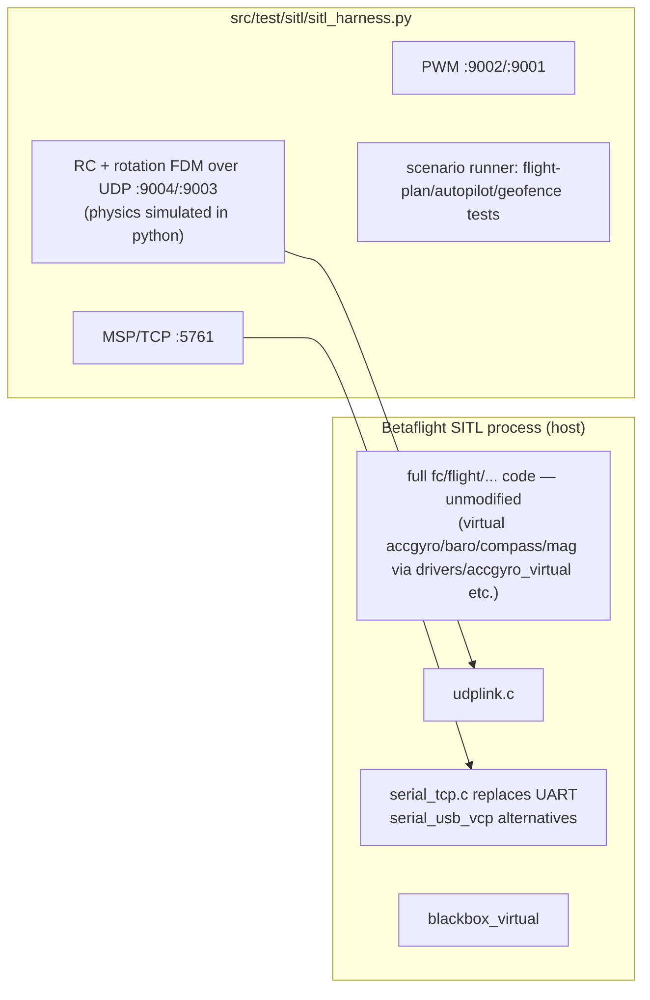

# 11. Build System & Testing

Files: [`Makefile`](https://github.com/betaflight/betaflight/blob/d593400a0/Makefile), [`mk/`](https://github.com/betaflight/betaflight/tree/d593400a0/mk), [`src/config/`](https://github.com/betaflight/config/tree/4961818ca9b6c463b4371e2e95f3e44da60b41a0) (submodule), [`src/test/`](https://github.com/betaflight/betaflight/tree/d593400a0/src/test).

## Two build modes: `TARGET` and `CONFIG`

Betaflight must ship both MCU-level *targets* (`STM32F405`) and user-facing *board configs* (`MATEKF405TE`). The build system supports both:



## The `platform.h` include contract

`src/main/platform.h:29-36` — the order is fixed and meaningful:

```c
#ifdef USE_CONFIG
#include "config.h"              // board config (CONFIG= builds only)
#endif
#include "target/common_pre.h"   // firmware-side pre-includes (src/main/target/)
#include "platform/platform.h"   // src/platform/<FAMILY>/include/platform/platform.h
#include "target.h"              // src/platform/<FAMILY>/target/<MCU>/target.h
#include "target/common_post.h"  // fix-up defaults, USE_/ENABLE_ normalization
// then common_defaults_post.h per-family hardware defaults
```

- `common_pre.h` (622 LoC) turns on feature gates *before* target headers: hard-on `USE_PARAMETER_GROUPS`, `USE_DSHOT(+BITBANG/TELEMETRY/STATS)`, `USE_MOTOR/DMA/TIMER`; family-dependent inclusions of baro/flash/rx protocols; profile counts (`PID_PROFILE_COUNT 4` etc.); documents the **ENABLE_ vs USE_ migration** (`ENABLE_X` numeric `#if`-checkable, `USE_X` translated by `common_post.h`).
- `common_post.h` (1073 LoC) prunes impossible dependencies and normalizes defines. `common_defaults_post.h` fixes per-family hardware defaults.
- `USE_CONFIG` gates the "include all drivers" block in `common_pre.h:104-107` so CONFIG= builds compile only explicitly-enabled drivers.

## Source gathering

`mk/source.mk` holds the big lists: `PG_SRC`, `COMMON_SRC`, `RX_SRC`, `FLASH_SRC`, `SDCARD_SRC`, `SIZE_OPTIMISED_SRC`, `SPEED_OPTIMISED_SRC` (which set `FAST_CODE` placement), plus per-MCU lists from the family `.mk` (`MCU_COMMON_SRC`, `DEVICE_STDPERIPH_SRC`, `VCP_SRC`, `STARTUP_SRC`). Final:

```make
SRC := $(STARTUP_SRC) $(MCU_COMMON_SRC) $(TARGET_SRC) $(VARIANT_SRC)
SRC += $(FLASH_SRC) $(MSC_SRC) $(SDCARD_SRC) $(COMMON_SRC)   # minus MCU_EXCLUDES
```

`SIMULATOR_BUILD` guards (source.mk:316, 468) strip the big hardware driver lists from SITL builds. Options: `EXST`/`RAM_BASED` config placement, `DEBUG=INFO|GDB`, `FLASH_SIZE`, `OPTIONS=` tweak flags, `make configs` (submodule hydration), `make all_configs` (build every board).

Bootloader/config-placement affects the linker: `EXST` pads the image and patches an MD5 ("config-in-extended-SRAM or flash AT FC_VMA_ADDRESS").

## Toolchain

- `mk/tools.mk` downloads pinned toolchains per OS (`linux.mk`, `macosx.mk`, `windows.mk`); ARM GCC for MCU targets, host gcc for SITL.
- `mk/checks.mk` sanity-checks tool availability; `mk/system-id.mk` fingerprints the host for CI caches.
- Artifacts: `TARGET_BIN/HEX/UF2/DFU/ZIP/TARGET_ELF/TARGET_EXST_ELF`.

## Unit tests

Directory: [`src/test/unit/`](https://github.com/betaflight/betaflight/tree/d593400a0/src/test/unit), framework: **GoogleTest** (vendored in `lib/test/gtest`, driven by `src/test/Makefile`):

```bash
make test   # in src/test/ — builds *_unittest.cc with a host compiler, XML output for CI
```

- Tests are C++ wrappers around C code compiled into the test harnesses (`unittest_c.c`-style glue).
- `check_pg_ids.awk` runs before the test suite to guard the PG id registry.
- Some tests use SITL-specific fakes (`blackbox_virtual.c` device, virtual sensor stubs).

## SITL (Software-In-The-Loop)

Directory: [`src/platform/SIMULATOR/`](https://github.com/betaflight/betaflight/tree/d593400a0/src/platform/SIMULATOR) + [`src/test/sitl/`](https://github.com/betaflight/betaflight/tree/d593400a0/src/test/sitl).

```bash
make TARGET=SITL                      # obj/main/betaflight_SITL.elf
make TARGET=SITL OPTIONS=SITL_STATIC  # static-ish binary, e.g. for CI images
```



- `SIMULATOR/target/SITL/target.mk` sets `TARGET_MCU=SIMULATOR`, `SIMULATOR_BUILD=yes`; `mk/SITL.mk` uses the host toolchain, `link/sitl.ld`, and `-lm -lpthread -lc -lrt`.
- Virtual sensors under `src/platform/SIMULATOR/` (accgyro/baro/compass/pitot/rangefinder) short-circuit hardware detection; `sitl.c` implements the link frame server; eeprom.bin is the config backing file (gitignored).
- SITL is how navigation/autopilot behaviors get regression-tested end-to-end (`src/test/sitl/` scenarios build with `USE_FLIGHT_PLAN`).

## CI-relevant targets (summary)

| Goal | Effect |
|---|---|
| `make CONFIG=<board>` | normal firmware build (recommended path) |
| `make CONFIG=<board> REV=yes` | revisioned artifact name |
| `make configs` | hydrate `src/config` (+ optional vendor SDK submodules) |
| `make all_configs` | iterate configs |
| `make test` (in `src/test`) | GoogleTest unit suite |
| `make TARGET=SITL` | host build for the SITL environment |
| `make clean`, `make clean-tarballs` | cleanup |
